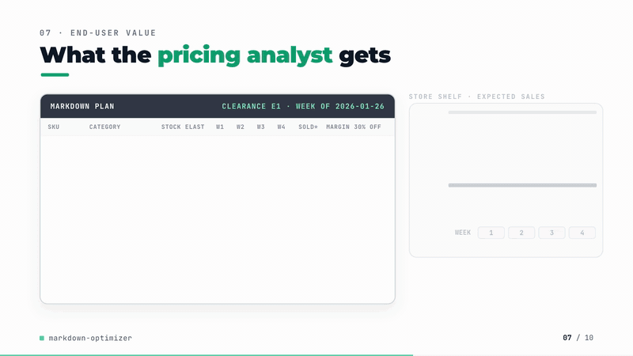
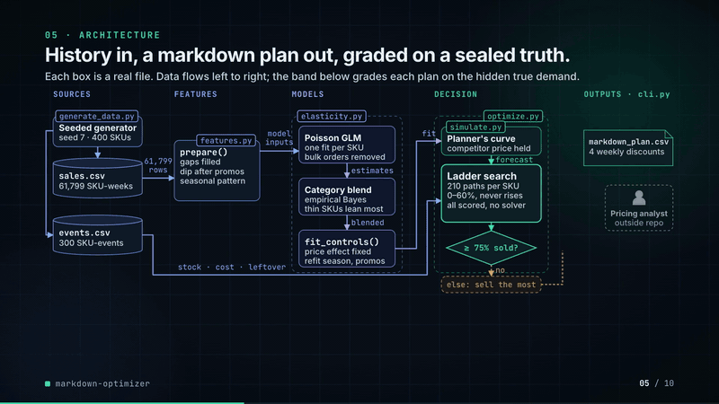

# markdown-optimizer

[](https://github.com/kavya2693/markdown-optimizer/actions/workflows/ci.yml)


How deep to mark down each slow-moving grocery SKU in a clearance event, worked out from its
own price elasticity instead of a blanket 30% off, and checked against demand where the right
answer is known.

[](docs/demo/demo.mp4)

*89-second silent walkthrough. Click for the full video ([MP4, 6 MB](docs/demo/demo.mp4)).*

📄 **Audit report:** every figure and assumption in the video, traced to its source — [PDF](docs/demo/AUDIT_REPORT.pdf) · [Word](docs/demo/AUDIT_REPORT.docx) · [Markdown](docs/demo/AUDIT_REPORT.md)

## At a glance

| | |
|---|---|
| **Problem** | A grocery chain clears 100 slow-moving SKUs per event with a blanket 30% off. It is too deep on price-sensitive SKUs (margin given away) and too shallow on insensitive ones (stock written off), and nobody can check a better plan because the counterfactual price was never charged. |
| **Approach** | Per-SKU own-price and competitor elasticity from a Poisson GLM, shrunk towards the category mean by empirical Bayes; exhaustive search over all 210 non-decreasing markdown paths per SKU-event for the best margin that still clears 75% of stock; every plan scored on the true demand curve with the competitor prices that actually happened. |
| **Result** | Promotional margin **56,628 against 18,877** for the 30% rule (**+37,750 ± 8,252**, paired over 300 SKU-events), **87% of the gap** to a planner that knows the true curve. Partial pooling cuts elasticity error **0.385 to 0.279 MAE** (-28%) against fitting each SKU alone. |
| **What didn't win** | Better elasticities barely move the money: pooling adds **1,046 ± 1,042** margin, under 2% of the total. A single 20% depth chosen in hindsight gets 63% of the gain with no model. The plan sells through less than the 30% rule (92.0% vs 93.0%) and hits the clearance target slightly less often (90.6% vs 92.1%). |

## Architecture

```mermaid
flowchart LR
    subgraph SRC["Sources"]
        GEN["Seeded generator<br/>scripts/generate_data.py<br/>data.generate"]
        SALES[("sales.csv<br/>156 weeks x 400 SKUs<br/>gaps, stockouts, bulk orders")]
        EVT[("events.csv<br/>3 events x 100 SKUs")]
        SKU[("skus.csv<br/>unit cost, regular price")]
        TRUTH[("data/truth/<br/>sku_params.csv<br/>future_competitor_index.csv")]
    end

    subgraph FEAT["Data and features"]
        PREP["Clean + design matrix<br/>features.prepare"]
    end

    subgraph MOD["Models"]
        GLM["Per-SKU Poisson GLM, IRLS<br/>outlier refit<br/>elasticity.fit_unpooled"]
        EB["Empirical-Bayes shrink<br/>DerSimonian-Laird per category<br/>elasticity.shrink"]
        CTRL["Refit controls, slope fixed<br/>elasticity.fit_controls"]
    end

    subgraph DEC["Decision and optimiser"]
        CPI["Competitor index held<br/>at last observed value<br/>pipeline.run"]
        MD["Planner's demand curve<br/>simulate.model_demand"]
        LAD["210 ladder paths, scored<br/>optimize.ladder_paths<br/>optimize.score_paths"]
        CH["Best margin with<br/>75% sell-through<br/>optimize.choose"]
        FIX["Fixed and blanket rules<br/>optimize.fixed_plan"]
        ORC["Oracle planner<br/>simulate.oracle_demand"]
    end

    subgraph EVAL["Evaluation"]
        SIM["Scorer on the true curve<br/>400 paired draws<br/>simulate.simulate"]
        ERR["Elasticity error vs truth<br/>pipeline.elasticity_error"]
        LIFT["Promotion lift vs<br/>true counterfactual<br/>lift.evaluate_lift"]
        SUM["Paired 95% intervals<br/>simulate.summarise"]
    end

    subgraph OUT["Outputs"]
        REP[("outputs/<br/>report.md · results.json<br/>markdown_plan.csv · *.csv")]
    end

    GEN --> SALES & EVT & SKU & TRUTH
    SALES -->|"SKU-weeks"| PREP
    PREP -->|"log price, log competitor index,<br/>promo, dip, Fourier, holiday, trend"| GLM
    GLM -->|"beta, gamma + standard errors"| EB
    EB -->|"pooled beta, gamma"| CTRL
    PREP -->|"non-stockout rows"| CTRL
    CTRL -->|"coefficients per SKU"| MD
    CPI --> MD
    EVT -->|"stock, cost, salvage, start week"| LAD
    MD -->|"expected units (7 rungs x 4 weeks)"| LAD
    LAD -->|"margin, sell-through per path"| CH
    CH -.->|"no path reaches 75%:<br/>take highest sell-through"| CH
    CH -->|"depth_w1..w4"| SIM
    FIX -->|"depth_w1..w4"| SIM
    ORC -->|"depth_w1..w4"| SIM
    TRUTH -->|"true params, realised competitor prices"| SIM
    TRUTH --> ORC
    TRUTH --> ERR
    TRUTH --> LIFT
    EB --> ERR
    CTRL --> LIFT
    SKU --> LIFT
    SIM -->|"margin, sell-through per SKU-event"| SUM
    PREP -.->|"stockout weeks dropped,<br/>competitor gaps carried forward"| GLM
    SUM --> REP
    ERR --> REP
    LIFT --> REP

    classDef data fill:#7fa8ff,stroke:#3d6fd9,color:#0b1020
    classDef model fill:#b9a2ff,stroke:#7a5fd6,color:#0b1020
    classDef decision fill:#3fd8a8,stroke:#1f9c76,color:#0b1020
    classDef evaluation fill:#f2c46d,stroke:#b8902f,color:#0b1020
    classDef risk fill:#ff8a73,stroke:#cc5640,color:#0b1020

    class GEN,SALES,EVT,SKU,PREP,REP data
    class GLM,EB,CTRL,MD model
    class LAD,CH,FIX,ORC decision
    class SIM,ERR,LIFT,SUM evaluation
    class TRUTH,CPI risk
```





Solid edges are the data flow of one run; dotted edges are the cleaning and fallback paths. Red
nodes mark the boundary the planner cannot see across: the true parameters and realised
competitor prices are read only by the oracle and the evaluation code, and the planner works
from a competitor index frozen at its last observed value.

### Components

| Component | Responsibility | File |
|---|---|---|
| Data generator | Chain-level sales history with promotions, competitor deals, stockouts, bulk orders and gaps; clearance events; the true parameters | [`scripts/generate_data.py`](scripts/generate_data.py), [`src/markdown_optimizer/data.py`](src/markdown_optimizer/data.py) |
| Policy and constants | Categories, discount ladder (0-60%), 30% rule, event length, 75% sell-through target, salvage at 30% of cost | [`src/markdown_optimizer/config.py`](src/markdown_optimizer/config.py) |
| Features | Competitor gap fill, post-promotion flag on the full week grid, two Fourier harmonics, holiday, trend | [`src/markdown_optimizer/features.py`](src/markdown_optimizer/features.py) |
| Elasticity | Poisson GLM by IRLS with outlier refit; no, complete and partial pooling; control refit with the pooled slope as an offset | [`src/markdown_optimizer/elasticity.py`](src/markdown_optimizer/elasticity.py) |
| Promotion lift | Model and four-week pre-period baselines; incremental margin of each past promotion, scored on the true counterfactual | [`src/markdown_optimizer/lift.py`](src/markdown_optimizer/lift.py) |
| Optimiser | Enumerates non-decreasing ladder paths, scores margin and sell-through, applies the constraint and the fallback | [`src/markdown_optimizer/optimize.py`](src/markdown_optimizer/optimize.py) |
| Scorer | Planner, oracle and true demand curves; paired draws per SKU-event; paired intervals and headroom captured | [`src/markdown_optimizer/simulate.py`](src/markdown_optimizer/simulate.py) |
| Orchestrator | Every estimator and policy, the hindsight blanket arm, the seed sweep, and every file in `outputs/` | [`src/markdown_optimizer/pipeline.py`](src/markdown_optimizer/pipeline.py), [`src/markdown_optimizer/cli.py`](src/markdown_optimizer/cli.py) |

### Design decisions

| Decision | Options considered | Chosen | Trade-off |
|---|---|---|---|
| Demand model | OLS on log(units + 1); Poisson GLM | Poisson GLM with log link by IRLS, quasi-Poisson standard errors, one outlier refit ([ADR-0001](docs/adr/0001-glm-with-empirical-bayes-and-exhaustive-ladder-search.md)) | No constant to bias thin SKUs towards zero; assumes the constant-elasticity form, which the evaluation cannot challenge |
| Sharing strength across SKUs | Each SKU alone; category mean; empirical-Bayes shrinkage; full hierarchical Bayes (PyMC / Stan) | Empirical Bayes, DerSimonian-Laird within category | Same shrinkage behaviour in well under a minute with numpy only; no posterior, which nothing downstream uses |
| Markdown search | MILP solver; reinforcement-learning pricing; exhaustive enumeration | All 210 non-decreasing paths over 7 rungs and 4 weeks | Exact, dependency-free and explainable to a merchant; would not scale to many more rungs or weeks without a solver |
| Objective and constraint | Maximise sell-through; maximise margin; margin with a sell-through floor | Margin including the leftover write-down, subject to 75% expected sell-through | Plans right up to the line on expected demand, so noise pushes some events under it (90.6% hit rate vs 92.1%) |
| How plans are judged | Score on the fitted model; score on the true curve | True curve with realised competitor prices and paired demand draws; never the model that made the plan | Only possible with known ground truth; it cannot catch a wrong functional form because generator and estimator share one |
| Seasonality | 52 week-of-year dummies; Fourier terms | Two Fourier harmonics on the week index | Keeps a third of the degrees of freedom on three years of history; cannot fit a sharp one-week spike other than the holiday flag |

### Data contracts

| Stage | Input | Output |
|---|---|---|
| Generator | seed, SKU count, `ClearancePolicy` | `sales.csv`: `week` (date), `t` (int), `sku_id, category` (str), `regular_price, discount, price` (float), `promo` (0/1), `competitor_index` (float, 2% missing), `units` (int), `stockout` (0/1); `events.csv`: `event_id, sku_id, category, start_t, start_week, weeks, opening_stock, regular_price, unit_cost, salvage_value`; `skus.csv`: `sku_id, category, price_ref, unit_cost, regular_price`; `truth/`: per-SKU `beta, gamma, delta, dip, ...` and the event-period competitor index |
| Features | `sales.csv` rows | same rows plus `log_price, log_cpi, const, post_promo, sin1, cos1, sin2, cos2, holiday, trend` (float) |
| Elasticity | prepared rows | one table per estimator: `sku_id, category, n_weeks, n_promo_weeks, mean_units, beta, gamma` |
| Control refit | prepared rows, one elasticity table | coefficients indexed by `sku_id`: `log_price, log_cpi, const, promo, post_promo, sin1..cos2, holiday, trend` |
| Planner | event row, depth vector | expected units, array `(n_rungs, n_weeks)`; plan rows `event_id, sku_id, depth_w1..depth_w4, planned_margin, planned_sell_through` |
| Scorer | events, plan, true params, realised competitor index | per SKU-event `margin, units_sold, sell_through, hit_target, mean_depth` (means over draws); summarised to `markdown_summary.csv` |

### Failure modes and fallbacks

| Failure | What the code does |
|---|---|
| Store-week file missing (1% of SKU-weeks) | The row is absent and the fit uses the weeks that exist. The post-promotion flag is computed from the full set of promotion weeks, so a missing row does not hide the week after a promotion. |
| Competitor price missing (2% of rows) | Carried forward within the SKU, then back-filled at the start of the history. |
| Stockout week | Dropped from every fit, because it records what was on the shelf rather than what was wanted. |
| Bulk order or outlier | Rows with a Pearson residual above 5 are dropped and the GLM is refitted once; if that would leave too few rows, the first fit is kept. |
| SKU with almost no price history | Empirical Bayes pulls it towards its category mean in proportion to its standard error. If the between-SKU variance comes out as zero, every SKU in the category gets the mean. |
| No markdown path reaches 75% expected sell-through | The path with the highest sell-through is chosen, because the stock has to go regardless; the shortfall shows in the hit rate rather than being hidden. |
| Competitor prices during the event are unknown | The planner holds the last observed index. Competitor reaction to our markdowns is not modelled; this is listed in the limitations. |
| Elasticity model degrades over time | Not handled. Estimates are refitted on each run and are not monitored for drift. |
| Solver or LLM timeout | Not applicable: the search enumerates a fixed 210 paths per SKU-event, and there is no solver, model server or network call. |

### Path to production

This is a mapping of each local piece to what would replace it in a deployed system, not a
description of one that exists.

| Here | Production equivalent |
|---|---|
| Seeded generator writing CSVs to `data/` | Weekly POS sales, price and promotion history and stock positions in a warehouse (BigQuery, Snowflake or Redshift), partitioned by week |
| Generated competitor index | A competitor price-check feed joined by SKU and week, with its own freshness check |
| `make run` on a laptop | Two scheduled jobs in Airflow or Step Functions: a weekly elasticity refit, and a plan job triggered when a clearance event is created |
| Per-SKU IRLS loop in one process | The same code fanned out by category (Ray, Spark or one container job per category on Cloud Run Jobs / AWS Batch) |
| Elasticity tables in memory | Versioned elasticity tables in a registry (MLflow, Vertex AI or SageMaker), promoted only if out-of-sample demand error does not get worse |
| Scorer on the true demand curve | A store-split test: optimised depths in a random half of stores, the 30% rule in the rest, margin and sell-through compared per event |
| `outputs/markdown_plan.csv` | Recommended depths pushed to the pricing system for merchant approval, then to shelf-label printing |
| Monitoring (not built) | Weekly sell-through during an event against the plan's expectation; elasticity drift by category; share of events falling back to the highest-sell-through path; mid-event re-plan when a SKU runs behind |

## The problem

A grocery chain ends every season with SKUs it overbought: holiday confectionery, a snack
flavour that did not take, a cleaning product the supplier is replacing. Each one has a few
weeks of shelf space left before the leftovers go to a liquidator for a fraction of cost. A
pricing analyst has to choose a markdown for a hundred or more of these per event, and in
practice the answer is a rule: 30% off everything, deepen it if it is still there in two weeks.

The rule is easy to run and easy to defend, and it is wrong in both directions at once. On a
price-sensitive SKU, 30% off clears the shelf in a week and gives away margin that 10% would
have kept. On an insensitive one, 30% is not enough, the stock is still there at the end, and
the write-down eats what the markdown earned. Nobody sees this, because the only number anyone
looks at afterwards is whether the shelf emptied.

## Why it is hard

The decision needs one number per SKU that is never observed directly: how much demand moves
when the price moves. A typical SKU is promoted a handful of times a year, usually in peak
season (so the promotion and the season are tangled together), sometimes in a week when a
competitor is also on deal (so part of the lift is theirs), and the data has stockouts, missing
store-week files and caterers buying in bulk. Fitted SKU by SKU, a quarter of the estimates are
off by half a unit of elasticity or more.

The other half of the problem is that nobody can check a markdown recommendation on real data,
because the counterfactual price was never charged. A tool that says "this plan made more
money" is only as good as the demand model it was scored on, which is usually the same model
that made the plan.

## The approach

Elasticity is estimated per SKU with a log-log demand model (own price, competitor price index,
promotion, post-promotion dip, seasonality, holiday, trend), fitted as a Poisson GLM, and then
shrunk towards its category mean by empirical Bayes so that SKUs with little price history
borrow from their neighbours while well-measured SKUs keep their own estimate. For each
clearance event, every non-decreasing markdown path on a 0-60% ladder over four weeks is scored
and the one with the best margin that still clears 75% of the stock is chosen.

The key decision is how the plans are judged. The dataset is generated from known true
elasticities, and every plan is scored on that true demand curve, with the competitor prices
that actually happened during the event, which the planner never sees. Nothing is scored on
the model that produced it. See [ADR-0001](docs/adr/0001-glm-with-empirical-bayes-and-exhaustive-ladder-search.md).

## The result

300 SKU-events across three clearance events, 400 demand draws each, seed 7. Promotional margin
is gross margin over the event including the write-down on leftovers, in currency units. The
95% interval is paired over SKU-events against the 30% rule.

| Policy | Promotional margin | vs 30% rule | Sell-through | Events hitting 75% target |
|---|---:|---:|---:|---:|
| No markdown | -39,393 | -58,270 | 49.5% | 7.4% |
| Fixed 30% off | 18,877 | — | 93.0% | 92.1% |
| Best single depth for all SKUs, chosen in hindsight (20%) | 42,761 | +23,884 ± 6,475 | 82.6% | 71.1% |
| Per-SKU plan, no pooling | 55,582 | +36,705 ± 8,347 | 91.0% | 89.1% |
| Per-SKU plan, complete pooling | 53,458 | +34,581 ± 8,048 | 92.4% | 92.0% |
| **Per-SKU plan, partial pooling** | **56,628** | **+37,750 ± 8,252** | 92.0% | 90.6% |
| Per-SKU plan, partial pooling without competitor index | 55,096 | +36,219 ± 8,173 | 92.4% | 91.2% |
| Planner that knows the true curve (upper bound) | 62,373 | +43,496 | 92.3% | 92.1% |

The two metrics disagree. The optimised plan triples the margin of the 30% rule and captures
87% of the gap to a planner that knows the true curve, but it sells through less (92.0% against
93.0%) and misses the clearance target slightly more often (90.6% of events against 92.1%),
because it plans right up to the 75% line on expected demand and noise pushes some events under
it. The 30% rule sells more because it gives more away.

The finding I did not want: **better elasticities barely move the money.** Partial pooling cuts
elasticity error by 28% against fitting each SKU alone, and the margin gain from that is 1,046
± 1,042, under 2% of the total. Across five data seeds partial pooling beat no pooling every
time, but only by 900 to 1,854. Most of the gain comes from making the decision per SKU with a
clearance constraint at all. The hindsight blanket depth, the arm most likely to embarrass the
optimiser, gets 63% of the gain over the 30% rule with no model, but it misses the clearance
target on almost a third of events.

Elasticity error against the true value (mean absolute error, own-price elasticity):

| Estimator | All SKUs | Fewest promotions (bottom third) | Rest | Bias | Competitor elasticity MAE |
|---|---:|---:|---:|---:|---:|
| No pooling | 0.385 | 0.497 | 0.330 | +0.017 | 0.166 |
| Complete pooling (category mean) | 0.334 | 0.347 | 0.328 | -0.056 | 0.154 |
| **Partial pooling** | **0.279** | **0.321** | **0.258** | +0.000 | 0.113 |
| Partial pooling, competitor index left out | 0.299 | 0.336 | 0.280 | +0.077 | — |

Pooling helps most where price history is thinnest, as it should. Leaving the competitor index
out biases own-price elasticity by +0.08, because competitors sometimes match a promotion in the
same week and their price cut gets credited to ours.

Promotional lift against the true counterfactual (6,531 historical promotion weeks):

| Baseline | Baseline WAPE | Lift bias | Correctly calls whether a promotion lost margin |
|---|---:|---:|---:|
| Demand model, regular price and no promotion in the same week | 3.7% | +0.6% | 86.8% |
| Mean of the last four clean weeks | 13.0% | -0.7% | 84.0% |

82% of historical promotions lost margin against their true counterfactual. The model baseline
is far closer week by week, but both baselines are nearly unbiased in total, and the
pre-period average still classifies most promotions correctly, because most promotions lose
money by a wide margin.

Across seeds 7 to 11 ([outputs/seed_sweep.csv](outputs/seed_sweep.csv)): elasticity MAE 0.405
± 0.038 unpooled and 0.265 ± 0.015 pooled, share of oracle headroom captured 0.869 ± 0.008,
sell-through 92.9% ± 1.2 for the 30% rule against 91.0% ± 1.3 for the plan. The 30% rule's
margin swings from 1,599 to 19,942 by seed; the plan's gain over it does not depend on that.

## How it works

```
sales history ──► prepare ──► per-SKU Poisson GLM ──► empirical-Bayes shrink ──► refit controls
(stockouts dropped,          (own price, competitor   (per category,             with pooled
 gaps filled,                 index, promo, dip,       DerSimonian-Laird)         elasticities fixed)
 dip flagged)                 season, holiday, trend)                                    │
                                                                                         ▼
clearance events ──────────────────────────────► 210 ladder paths per SKU-event ──► best margin
(opening stock, cost, salvage)                    scored on expected demand          with ≥75% expected
                                                                                     sell-through
                                                                                         │
true demand curve + realised competitor prices ──► 400 paired draws per SKU-event ◄──────┘
```

A path never raises the price mid-event. If no path reaches 75% expected sell-through, the plan
takes the one that sells the most, since the stock has to go regardless, and the shortfall
shows up in the hit rate. Leftovers are sold to a liquidator at 30% of unit cost.

## Running it

```bash
uv sync
make data            # writes data/ from seed 7
make run             # full study, writes outputs/
make sweep           # same, plus seeds 8-11 into outputs/seed_sweep.csv
make check           # ruff, format, mypy, pytest
docker build -t markdown-optimizer . && docker run --rm markdown-optimizer
```

Every number above comes from [outputs/report.md](outputs/report.md),
[outputs/results.json](outputs/results.json) and the CSVs next to them; the console output of
the run is in [outputs/run_log.txt](outputs/run_log.txt). The chosen markdown path for every
SKU-event, with its realised margin next to the 30% rule's, is in
[outputs/markdown_plan.csv](outputs/markdown_plan.csv). Policy (target, salvage share, ladder)
is in `src/markdown_optimizer/config.py`.

```
src/markdown_optimizer/
  data.py         seeded generator and the true demand function
  features.py     design matrix: Fourier seasonality, holiday, post-promotion flag
  elasticity.py   Poisson GLM by IRLS, outlier refit, empirical-Bayes pooling
  lift.py         counterfactual baselines and incremental margin of past promotions
  optimize.py     ladder paths, margin and sell-through scoring, constrained choice
  simulate.py     scores plans on the true curve with paired demand draws
  pipeline.py     runs every estimator and policy; cli.py writes outputs/
```

## The data

The dataset is generated by the seeded script `scripts/generate_data.py` (`make data`) and
sized to the production problem; the production data is proprietary. It covers a 60-store
grocery chain at chain level: 400 SKUs in 12 categories, 156 weeks of history (about 61,800
SKU-weeks), and three four-week clearance events of 100 slow-moving SKUs each.

Each SKU draws its true own-price elasticity from its category mean (-1.2 to -2.9) with
between-SKU spread 0.4, plus a competitor cross-elasticity, promotion display lift, a
post-promotion dip, seasonality, holiday uplift and trend. Promotions are more likely in peak
season and holiday weeks. Competitors run their own deals and match ours 35% of the time.
Sales are negative binomial (about 16% noise on a high-volume SKU), with 0.5% bulk-order spikes,
stockouts that cap sales (6% of promotion weeks, 2% otherwise), 1% of SKU-weeks missing and 2%
of competitor prices missing. Opening stock for a clearance SKU is 5 to 11 weeks of
regular-price demand. The true parameters are written to `data/truth/` and are read only by the
evaluation code.

The limit that matters: the generator uses the same constant-elasticity form the estimator
assumes, so model misspecification costs nothing here and would cost something on real data.

## Tests

`tests/test_optimize.py::test_a_wrong_sign_curve_never_marks_down` feeds the optimiser a
deliberately broken demand curve in which discounts reduce demand. It must not mark down, and
the clearance shortfall must be visible rather than hidden. Together with the hand-computed
margin check in `test_score_caps_sales_at_remaining_stock`, this is what makes the margin
numbers above trustworthy.

`tests/test_pipeline.py::test_pooling_beats_no_pooling_on_elasticity_error` runs the whole
pipeline on a fresh 150-SKU dataset with a different seed and checks that pooling lowers
elasticity error and that the gain is larger for SKUs with few promotions. If shrinkage were
pulling well-measured SKUs as hard as noisy ones, the second assertion would fail. The GLM
itself is checked for recovering known coefficients to within 0.05.

18 tests, about 25 seconds, no network and no model server.

## Known limitations

- **Biggest gap: the evaluation cannot catch a wrong functional form.** Data and estimator share
  the constant-elasticity log-log form. On real data, elasticity usually rises with discount
  depth, and the optimiser would then be extrapolating to 50-60% off from promotions that
  rarely went past 30%.
- The planner optimises expected demand. A version that plans against demand quantiles would
  trade some margin for hitting the clearance target more often; it is not built.
- No cannibalisation or halo between SKUs: marking down one snack does not take sales from
  another.
- Competitor prices during an event are held at their last observed value when planning, and
  competitors do not react to our markdowns. The scorer uses the prices that actually happened.
- The incremental margin of past promotions ignores the post-promotion dip, so it flatters
  promotions slightly.
- The resume line this backs also mentions a promotion calendar. This repository measures lift
  and margin of past promotions but does not optimise a calendar.
- One price zone at chain level. Store-level elasticity and stock positions are not modelled.

## Insights and learning

I picked markdowns because it is the pricing decision where a wrong answer is most visible
after the fact and least understood before it. Everyone sees the leftover stock; nobody sees
the margin a too-deep markdown gave away on the SKUs that cleared. Building the scorer first,
on a curve where the true elasticity is known, was the only way to see both sides.

What surprised me was how little the elasticity accuracy mattered once the decision was
framed properly. I expected pooling to be the headline, and on estimation error it is. But a
discrete ladder with a sell-through floor is forgiving: an elasticity off by 0.3 usually lands
on the same rung or the next one, and the clearance constraint stops the worst mistakes. The
structure of the decision carried more value than the precision of the estimate.

What I got wrong at first was the noise level. With the first setting, single-SKU estimates
were so noisy that pooling looked almost like replacing every SKU with its category mean. Chain
level weekly sales sum dozens of stores and are much smoother than that, and once the noise
matched that, partial pooling separated cleanly from both extremes.

Next I would let elasticity vary with depth (a piecewise or spline price term) and break the
shared functional form between generator and estimator, which is the test this project cannot
yet pass. After that, planning against the 25th percentile of demand instead of the mean, to
see what it costs in margin to match the 30% rule's clearance rate.

## License

MIT
