# markdown-optimizer: demo video audit report

**Repository:** https://github.com/kavya2693/markdown-optimizer  
**Numbers taken from commit:** `53fed34` (outputs last changed in `53fed34 (2026-10-13 17:54:44 +0400)`)  
**Video:** `docs/demo/demo.mp4` (91.4 s, 1920x1080, 30 fps, silent)  
**Generated:** 2026-10-14 18:43  
**Automated checks:** 70 pass · 0 fail · 3 manual (of 73 figures)

## How to use this report

Every number or claim on screen has an ID (`F-01`, `F-02`, ...) and every modelling assumption has an ID (`A-01`, ...). Cite the ID. Each figure lists its source file, the exact column/row/key, the formula for derived numbers, and an automated check result. The change-impact matrix tells you which slides and files change if an input or assumption changes.

Types: **direct** = read straight from a repo output; **derived** = computed from direct values (formula given); **illustrative** = drawing or example, not data; **general knowledge** = context not produced by the repo.

### Regenerate

```bash
make run                                   # data/ (seed 7) and outputs/*.csv, results.json, report.md (~10 s)
make sweep                                 # adds outputs/seed_sweep.csv (seeds 7-11)
PYTHONPATH=src .venv/bin/python docs/demo/source/tools/export_markdown_sheet.py docs/demo/source/assets/markdown_sheet.json
python3 docs/demo/source/tools/inject_sheet.py docs/demo/source/assets/markdown_sheet.json docs/demo/source/compositions/value.html --rows SKU0222,SKU0315,SKU0195,SKU0271,SKU0199,SKU0169 --animate SKU0222,SKU0315,SKU0195,SKU0271
python3 docs/demo/source/tools/inject_running.py . docs/demo/source/compositions/s04-running.html
python3 docs/demo/source/tools/plan_heatmap.py outputs/markdown_plan.csv docs/demo/source/assets/plan-heatmap.png
cd docs/demo/source && npx --yes hyperframes@0.8.156 check && npx --yes hyperframes@0.8.156 render -f 30 -q looks -o renders/markdown-optimizer-master.mp4 && cd -
ffmpeg -y -i docs/demo/source/renders/markdown-optimizer-master.mp4 -c:v libx264 -preset slow -crf 25 -pix_fmt yuv420p -movflags +faststart -an docs/demo/demo.mp4
python3 docs/demo/source/tools/build_audit_report.py docs/demo/source/audit/facts.yaml   # stills, checks, MD/DOCX/PDF
```

## 1. Figures

| ID | Shown on screen | Slides | Source | Column / row / key | How computed | Type | Check |
|---|---|---|---|---|---|---|---|
| F-01 | 3 industry chips | 01 | `author's framing` | - | - | general knowledge | manual: Context statement, not a repo output. |
| F-02 | 4 problem cards | 01 | `README 'The problem'` | README lines 13-27 | - | general knowledge | ✓ verified |
| F-03 | 400 SKUs / seed 7 · 400 SKUs | 02, 05 | `data/skus.csv` | row count | - | direct | ✓ verified |
| F-04 | 12 categories | 02 | `data/skus.csv` | category (distinct) | - | direct | ✓ verified |
| F-05 | 3 events | 02 | `data/events.csv` | event_id (distinct) | - | direct | ✓ verified |
| F-06 | × 100 slow movers | 02 | `data/events.csv` | rows per event_id | min = max = 100 | direct | ✓ verified |
| F-07 | 156 weeks of sales history | 02 | `data/sales.csv` | t (distinct) | - | direct | ✓ verified |
| F-08 | 61,799 SKU-weeks / 61,799 rows | 05 | `data/sales.csv` | row count (1% of SKU-weeks dropped as missing files) | - | direct | ✓ verified |
| F-09 | discounts 0–60% / 0–60%, never rises | 02, 05 | `src/markdown_optimizer/config.py:28` | LADDER | - | direct | ✓ verified |
| F-10 | over 4 weeks / 4-week markdown path | 02, 03, 04 | `data/events.csv` | weeks | all rows = 4 | direct | ✓ verified |
| F-11 | leftovers sell at 30% of cost | 02 | `data/events.csv; config.py:38` | salvage_value vs unit_cost | salvage_value = round(0.30 x unit_cost, 2) on every row | direct | ✓ verified |
| F-12 | slow movers | 02 | `src/markdown_optimizer/data.py:241-243` | slow = SKUs below the 60th percentile of base demand | - | direct | ✓ verified |
| F-13 | 3 years, every price change | 03 | `data/sales.csv` | t (distinct) | 156 weeks / 52 = 3 years | derived | ✓ verified |
| F-14 | score all 210 / 210 of them / 210 paths per SKU / scored 210 / 210 / best margin of 210 paths | 03, 04, 05, 09 | `src/markdown_optimizer/optimize.py:25-27; config.py:28-34` | ladder_paths(4, 7) | non-decreasing sequences of 4 from 7 rungs = C(7+4-1, 4) = 210 | derived | ✓ verified |
| F-15 | ✓ more margin ✓ stock clears ✓ checked on truth | 03 | `outputs/results.json; src/markdown_optimizer/simulate.py` | margin_partial_pooling > margin_fixed_30; sell_through_partial_pooling >= 0.75; simulate() scores on true_mean | - | derived | ✓ verified |
| F-16 | CLEAR 75% / clears 75% / ≥ 75% sold? / target 75% / 75% must sell | 03, 04, 05, 07, 08, 09 | `outputs/results.json` | sell_through_target | x 100 | direct | ✓ verified |
| F-17 | SKU0222 0% 0% 10% 10% · 5 → 212 | 04, 07 | `outputs/markdown_plan.csv` | event_id=E1, sku_id=SKU0222: depth_w1..w4, margin, fixed_30_margin | margins rounded to whole units | direct | ✓ verified |
| F-18 | SKU0138 30% 40% 40% 40% · 303 → 346 | 04 | `outputs/markdown_plan.csv` | event_id=E1, sku_id=SKU0138 | margins rounded to whole units | direct | ✓ verified |
| F-19 | 56,628 | 04, 06, 08, 09 | `outputs/results.json` | margin_partial_pooling | - | direct | ✓ verified |
| F-20 | 18,877 | 04, 06, 08, 09 | `outputs/results.json` | margin_fixed_30 | - | direct | ✓ verified |
| F-21 | 71% of them beat the rule | 04 | `outputs/markdown_summary.csv` | policy=partial_pooling, skus_better_than_fixed | x 100 | direct | ✓ verified |
| F-22 | the price never goes back up / never rises | 04, 05 | `outputs/markdown_plan.csv; optimize.py:1-6` | depth_w1..w4 non-decreasing on all 300 rows | - | direct | ✓ verified |
| F-23 | thin products lean on their category / steadied by its category / Category blend · empirical Bayes · thin SKUs lean most | 03, 04, 05 | `src/markdown_optimizer/elasticity.py:93-120` | dersimonian_laird, shrink(groups=category) | - | direct | ✓ verified |
| F-24 | generate_data.py, sales.csv, events.csv, features.py prepare(), Poisson GLM, Category blend (empirical Bayes), fit_controls(), simulate.py planner's curve, optimize.py ladder search, markdown_plan.csv, data/truth/, lift.py, simulate.py scorer, results.json, report.md, cli.py | 05 | `src/markdown_optimizer/*.py; scripts/; data/; outputs/` | see helper arch_boxes_exist() | - | direct | ✓ verified |
| F-25 | no → else: sell the most | 05 | `src/markdown_optimizer/optimize.py:50-57` | choose() | - | direct | ✓ verified |
| F-26 | seed 7 / seed 11 | 05, 08 | `outputs/results.json; src/markdown_optimizer/simulate.py:74` | seed; simulate(seed=11) | - | direct | ✓ verified |
| F-27 | 6,531 past promos | 05 | `outputs/lift_summary.csv` | baseline=model, promotions | - | direct | ✓ verified |
| F-28 | 400 paired draws × 300 SKU-events | 05, 08 | `src/markdown_optimizer/pipeline.py:62; data/events.csv` | run(draws=400); events rows | - | direct | ✓ verified |
| F-29 | + 7 CSVs | 05 | `src/markdown_optimizer/cli.py:24-31` | to_csv(out / ...) calls | count | direct | ✓ verified |
| F-30 | make run ≈ 10 s · offline / ~10 s | 05, 10 | `measured for this audit` | - | 9.9 s wall-clock, rounded | illustrative | manual: Single wall-clock measurement on the author's laptop (A-14); the repo does not record a run time. |
| F-31 | offline | 05 | `src/markdown_optimizer/*.py; README 'Tests'` | no networking imports | - | direct | ✓ verified |
| F-32 | data/truth/ · true price effects · eval code only · sealed | 05 | `src/markdown_optimizer/data.py:1-7; README 'The data'` | docstring + README | - | direct | ✓ verified |
| F-33 | competitor price held | 05 | `src/markdown_optimizer/simulate.py:21-35; pipeline.py:73` | model_demand(last_cpi) | - | direct | ✓ verified |
| F-34 | Poisson GLM · one fit per SKU · bulk orders removed | 05 | `src/markdown_optimizer/elasticity.py:31-64; pipeline.py:16` | poisson_irls, fit_robust (OUTLIER_PEARSON = 5.0), ESTIMATORS | - | direct | ✓ verified |
| F-35 | make sweep: seeds 8-11 | 05 | `Makefile; outputs/seed_sweep.csv` | seed column | - | direct | ✓ verified |
| F-36 | 0.385 / estimate error 0.385 | 06, 08, 09 | `outputs/results.json` | beta_mae_no_pooling | - | direct | ✓ verified |
| F-37 | 0.279 / estimate error 0.279 | 06, 08, 09 | `outputs/results.json` | beta_mae_partial_pooling | - | direct | ✓ verified |
| F-38 | Rarely promoted SKUs: 0.497 | 06 | `outputs/elasticity_error.csv` | estimator=no_pooling, beta_mae_few_promos | - | direct | ✓ verified |
| F-39 | → 0.321 | 06 | `outputs/elasticity_error.csv` | estimator=partial_pooling, beta_mae_few_promos | - | direct | ✓ verified |
| F-40 | −28% error / −28% / Blending cut the error 28% | 06, 08, 09 | `outputs/results.json` | beta_mae_partial_pooling, beta_mae_no_pooling | (0.2792 / 0.3854 - 1) x 100 = -27.6, rounded | derived | ✓ verified |
| F-41 | 400 points moving from 'alone' to 'pooled' | 06 | `outputs/elasticity_by_sku.csv (inlined by tools/inject_running.py)` | beta_true, beta_hat for estimator in {no_pooling, partial_pooling} | values rounded to 3 decimals for drawing | direct | ✓ verified |
| F-42 | 9 bar values | 06 | `outputs/markdown_by_event.csv (inlined by tools/inject_running.py)` | policy in {fixed_30, partial_pooling, oracle}, event_id, margin | - | direct | ✓ verified |
| F-43 | total 18,877 | 06 | `outputs/markdown_by_event.csv` | policy=fixed_30, margin | sum of E1..E3 | derived | ✓ verified |
| F-44 | → 56,628 | 06 | `outputs/markdown_by_event.csv` | policy=partial_pooling, margin | sum of E1..E3 | derived | ✓ verified |
| F-45 | 6 sheet rows | 07 | `demo:assets/markdown_sheet.json (tools/export_markdown_sheet.py) = outputs/markdown_plan.csv rows for E1` | see helper sheet_rows_match() | - | direct | ✓ verified |
| F-46 | margin 20,673 | 07 | `outputs/markdown_by_event.csv` | policy=partial_pooling, event_id=E1 | - | direct | ✓ verified |
| F-47 | vs 8,675 at 30% off | 07 | `outputs/markdown_by_event.csv` | policy=fixed_30, event_id=E1 | - | direct | ✓ verified |
| F-48 | 76 SKUs do better | 07 | `outputs/markdown_plan.csv` | event_id=E1, margin > fixed_30_margin | count | derived | ✓ verified |
| F-49 | 100 SKUs · + 94 more SKUs | 07 | `data/events.csv` | event_id=E1 rows | 100 - 6 shown = 94 | direct | ✓ verified |
| F-50 | −0.67 | 07 | `outputs/elasticity_by_sku.csv` | sku_id=SKU0222, estimator=partial_pooling, beta_hat | - | direct | ✓ verified |
| F-51 | 75% / 75% (shelf) | 07 | `outputs/markdown_plan.csv` | event_id=E1, sku_id=SKU0271, planned_sell_through | x 100 | direct | ✓ verified |
| F-52 | shelf animation | 07 | `demo:assets/markdown_sheet.json` | planned_stock_left | boxes left = round(10 x expected stock left) | illustrative | manual: Drawing; the proportions come from the planner's expected demand, not from realised sales. |
| F-53 | 3.0× | 08 | `outputs/results.json` | margin_partial_pooling / margin_fixed_30 | 56,628 / 18,877 = 3.0 | derived | ✓ verified |
| F-54 | 87% / 87% of the gap to a perfect planner | 08, 09 | `outputs/results.json` | oracle_headroom_captured | x 100 | direct | ✓ verified |
| F-55 | upper bound 62,373 | 08 | `outputs/results.json` | margin_oracle | - | direct | ✓ verified |
| F-56 | 92.0% | 08 | `outputs/results.json` | sell_through_partial_pooling | x 100 | direct | ✓ verified |
| F-57 | 30% rule sells 93.0% | 08 | `outputs/results.json` | sell_through_fixed_30 | x 100 | direct | ✓ verified |
| F-58 | +23,884 | 09 | `outputs/markdown_summary.csv` | policy=best_blanket_depth_hindsight, margin_vs_fixed_30 | - | direct | ✓ verified |
| F-59 | 20% for all · 20% was found in hindsight | 09 | `outputs/results.json` | best_blanket_depth | x 100 | direct | ✓ verified |
| F-60 | +36,705 | 09 | `outputs/markdown_summary.csv` | policy=no_pooling, margin_vs_fixed_30 | - | direct | ✓ verified |
| F-61 | +37,750 | 09 | `outputs/markdown_summary.csv` | policy=partial_pooling, margin_vs_fixed_30 | - | direct | ✓ verified |
| F-63 | only 1,046 | 09 | `outputs/pooling_comparison.csv` | comparison='partial_pooling - no_pooling', margin_difference | - | direct | ✓ verified |
| F-64 | ± 1,042 | 09 | `outputs/pooling_comparison.csv` | comparison='partial_pooling - no_pooling', ci95_halfwidth | 1.96 x sd x sqrt(n) | direct | ✓ verified |
| F-65 | Sharper estimates barely add margin. So I fixed the decision. | 09 | `README 'The result'` | README sentence | - | direct | ✓ verified |
| F-68 | +34,581 | 09 | `outputs/markdown_summary.csv` | policy=complete_pooling, margin_vs_fixed_30 | - | direct | ✓ verified |
| F-69 | estimate error 0.334 | 09 | `outputs/elasticity_error.csv` | estimator=complete_pooling, beta_mae | - | direct | ✓ verified |
| F-70 | clears 90.6% | 09 | `outputs/markdown_summary.csv` | policy=partial_pooling, share_events_hitting_target | x 100 | direct | ✓ verified |
| F-71 | clears 71.1% | 09 | `outputs/markdown_summary.csv` | policy=best_blanket_depth_hindsight, share_events_hitting_target | 0.7105 exactly (71.05%); x 100, rounded half up to 1 dp as in the README (Python's float format would give 71.0) | direct | ✓ verified |
| F-72 | clears 92.1% · today | 09 | `outputs/markdown_summary.csv` | policy=fixed_30, share_events_hitting_target | x 100 | direct | ✓ verified |
| F-73 | THE FIX, IN THE REPO · choose(): best margin of 210 paths that still clears 75% | 09 | `src/markdown_optimizer/optimize.py:50-73; tests/test_optimize.py:26` | choose(), plan_events() | - | direct | ✓ verified |
| F-74 | under 2% of the total | 09 | `outputs/pooling_comparison.csv; outputs/results.json` | margin_difference / margin_partial_pooling | 1,046 / 56,628 = 1.8% | derived | ✓ verified |
| F-66 | MIT | 10 | `LICENSE` | first line | - | direct | ✓ verified |
| F-67 | Poisson GLM · empirical Bayes · exhaustive ladder search · pandas | 10 | `src/markdown_optimizer/elasticity.py; optimize.py; pyproject.toml` | docstrings + dependencies | - | direct | ✓ verified |

## 2. Automated check run (2026-10-14 18:43)

| ID | Expected on slide | Recomputed from repo | Result |
|---|---|---|---|
| F-01 | 3 industry chips | - | manual |
| F-02 | true | true | ✓ pass |
| F-03 | 400 | 400 | ✓ pass |
| F-04 | 12 | 12 | ✓ pass |
| F-05 | 3 | 3 | ✓ pass |
| F-06 | true | true | ✓ pass |
| F-07 | 156 | 156 | ✓ pass |
| F-08 | 61,799 | 61,799 | ✓ pass |
| F-09 | true | true | ✓ pass |
| F-10 | true | true | ✓ pass |
| F-11 | true | true | ✓ pass |
| F-12 | true | true | ✓ pass |
| F-13 | true | true | ✓ pass |
| F-14 | 210 | 210 | ✓ pass |
| F-15 | true | true | ✓ pass |
| F-16 | 75 | 75 | ✓ pass |
| F-17 | true | true | ✓ pass |
| F-18 | true | true | ✓ pass |
| F-19 | 56,628 | 56,628 | ✓ pass |
| F-20 | 18,877 | 18,877 | ✓ pass |
| F-21 | 71 | 71 | ✓ pass |
| F-22 | true | true | ✓ pass |
| F-23 | true | true | ✓ pass |
| F-24 | true | true | ✓ pass |
| F-25 | true | true | ✓ pass |
| F-26 | true | true | ✓ pass |
| F-27 | 6,531 | 6,531 | ✓ pass |
| F-28 | true | true | ✓ pass |
| F-29 | 7 | 7 | ✓ pass |
| F-30 | make run ≈ 10 s · offline / ~10 s | - | manual |
| F-31 | true | true | ✓ pass |
| F-32 | true | true | ✓ pass |
| F-33 | true | true | ✓ pass |
| F-34 | true | true | ✓ pass |
| F-35 | true | true | ✓ pass |
| F-36 | 0.385 | 0.385 | ✓ pass |
| F-37 | 0.279 | 0.279 | ✓ pass |
| F-38 | 0.497 | 0.497 | ✓ pass |
| F-39 | 0.321 | 0.321 | ✓ pass |
| F-40 | -28 | -28 | ✓ pass |
| F-41 | true | true | ✓ pass |
| F-42 | true | true | ✓ pass |
| F-43 | 18,877 | 18,877 | ✓ pass |
| F-44 | 56,628 | 56,628 | ✓ pass |
| F-45 | true | true | ✓ pass |
| F-46 | 20,673 | 20,673 | ✓ pass |
| F-47 | 8,675 | 8,675 | ✓ pass |
| F-48 | 76 | 76 | ✓ pass |
| F-49 | 100 | 100 | ✓ pass |
| F-50 | -0.67 | -0.67 | ✓ pass |
| F-51 | 75 | 75 | ✓ pass |
| F-52 | shelf animation | - | manual |
| F-53 | 3.0 | 3.0 | ✓ pass |
| F-54 | 87 | 87 | ✓ pass |
| F-55 | 62,373 | 62,373 | ✓ pass |
| F-56 | 92.0 | 92.0 | ✓ pass |
| F-57 | 93.0 | 93.0 | ✓ pass |
| F-58 | 23,884 | 23,884 | ✓ pass |
| F-59 | 20 | 20 | ✓ pass |
| F-60 | 36,705 | 36,705 | ✓ pass |
| F-61 | 37,750 | 37,750 | ✓ pass |
| F-63 | 1,046 | 1,046 | ✓ pass |
| F-64 | 1,042 | 1,042 | ✓ pass |
| F-65 | true | true | ✓ pass |
| F-68 | 34,581 | 34,581 | ✓ pass |
| F-69 | 0.334 | 0.334 | ✓ pass |
| F-70 | 90.6 | 90.6 | ✓ pass |
| F-71 | 71.1 | 71.1 | ✓ pass |
| F-72 | 92.1 | 92.1 | ✓ pass |
| F-73 | true | true | ✓ pass |
| F-74 | true | true | ✓ pass |
| F-66 | true | true | ✓ pass |
| F-67 | true | true | ✓ pass |

## 3. Assumptions register

| ID | Assumption | Source | Used by | Sensitivity: if this changes |
|---|---|---|---|---|
| A-01 | All data is synthetic, produced by a seeded generator sized to the production problem (400 SKUs in 12 categories, 156 weeks, three 4-week clearance events of 100 slow movers). The production data is proprietary. | `src/markdown_optimizer/config.py:7-40; src/markdown_optimizer/data.py:168 (generate, seed=7); README 'The data'` | all figures | figures all figures and slides 01, 02, 03, 04, 05, 06, 07, 08, 09, 10 change |
| A-02 | The generator and the estimator share the same constant-elasticity log-log demand form, so model misspecification costs nothing here. On real data elasticity usually rises with discount depth. | `src/markdown_optimizer/data.py:49-69 (true_log_mu); src/markdown_optimizer/elasticity.py:1-13; README 'Known limitations' (biggest gap)` | F-17, F-18, F-19, F-36, F-37, F-38, F-39, F-40, F-41, F-42, F-43, F-44, F-53, F-54, F-58, F-60, F-61, F-63, F-64, F-68 | figures F-17, F-18, F-19, F-36, F-37, F-38, F-39, F-40, F-41, F-42, F-43, F-44, F-53, F-54, F-58, F-60, F-61, F-63, F-64, F-68 and slides 04, 06, 07, 08, 09 change |
| A-03 | A plan must reach 75% expected sell-through over the event; otherwise the path that sells the most is taken (fallback). | `src/markdown_optimizer/config.py:36 (sell_through_target = 0.75); src/markdown_optimizer/optimize.py:50-57 (choose)` | F-16, F-25, F-45, F-51, F-56, F-70, F-71, F-72, F-73 | figures F-16, F-25, F-45, F-51, F-56, F-70, F-71, F-72, F-73 and slides 03, 04, 05, 07, 08, 09 change |
| A-04 | Leftover units at the end of an event go to a liquidator at 30% of unit cost. | `src/markdown_optimizer/config.py:38 (salvage_share_of_cost = 0.30); data.py:265 (salvage_value)` | F-11, F-17, F-18, F-19, F-20, F-43, F-44, F-46, F-47, F-53, F-58, F-60, F-61, F-68 | figures F-11, F-17, F-18, F-19, F-20, F-43, F-44, F-46, F-47, F-53, F-58, F-60, F-61, F-68 and slides 02, 04, 06, 07, 08, 09 change |
| A-05 | Markdown ladder: 0-60% in 10-point steps, 4 weeks per event, depth never goes back up, so every SKU-event has exactly 210 candidate paths, all scored. | `src/markdown_optimizer/config.py:28 (LADDER), :34 (event_weeks = 4); src/markdown_optimizer/optimize.py:25-27 (ladder_paths)` | F-09, F-10, F-14, F-22 | figures F-09, F-10, F-14, F-22 and slides 02, 03, 04, 05, 09 change |
| A-06 | The business-as-usual baseline is 30% off every SKU for all four weeks. | `src/markdown_optimizer/config.py:29 (FIXED_RULE_DEPTH = 0.30)` | F-17, F-18, F-20, F-21, F-44, F-47, F-48, F-53, F-57, F-58, F-60, F-61, F-68 | figures F-17, F-18, F-20, F-21, F-44, F-47, F-48, F-53, F-57, F-58, F-60, F-61, F-68 and slides 04, 06, 07, 08, 09 change |
| A-07 | Plans are scored on the true demand curve with 400 paired negative-binomial demand draws per SKU-event (scorer seed 11, size 40, about 16% noise on a high-volume SKU), using the competitor prices that actually happened. | `src/markdown_optimizer/simulate.py:68-75 (draws=400, seed=11); data.py:22 (NB_SIZE = 40.0)` | F-15, F-19, F-20, F-26, F-28, F-43, F-44, F-46, F-47, F-53, F-54, F-56, F-57, F-58, F-60, F-61, F-63, F-64, F-68 | figures F-15, F-19, F-20, F-26, F-28, F-43, F-44, F-46, F-47, F-53, F-54, F-56, F-57, F-58, F-60, F-61, F-63, F-64, F-68 and slides 03, 04, 05, 06, 07, 08, 09 change |
| A-08 | When planning, the competitor price index is held at its last observed value and competitors do not react to our markdowns. The scorer uses the prices that actually happened. | `src/markdown_optimizer/simulate.py:21-35 (model_demand); pipeline.py:73; README 'Known limitations'` | F-33, F-19, F-44, F-53 | figures F-33, F-19, F-44, F-53 and slides 04, 05, 06, 08, 09 change |
| A-09 | The planner optimises expected demand, not a demand quantile; noise pushes some events below the 75% line (90.6% of events hit it vs 92.1% for the 30% rule). | `src/markdown_optimizer/optimize.py:64-77; README 'Known limitations'` | F-51, F-56, F-57, F-70, F-72 | figures F-51, F-56, F-57, F-70, F-72 and slides 07, 08, 09 change |
| A-10 | No cannibalisation or halo between SKUs; one price zone at chain level. | `README 'Known limitations'` | F-19, F-44, F-53 | figures F-19, F-44, F-53 and slides 04, 06, 08, 09 change |
| A-11 | True own-price elasticities are drawn around category means of -1.2 to -2.9 with between-SKU spread 0.4 (capped at -0.4); competitors match our promotions 35% of the time. | `src/markdown_optimizer/config.py:13-24; src/markdown_optimizer/data.py:110 (beta), :179 (match 0.35)` | F-36, F-37, F-38, F-39, F-40, F-41 | figures F-36, F-37, F-38, F-39, F-40, F-41 and slides 06, 08, 09 change |
| A-12 | Video rounding: margins to whole currency units with thousands separators, percentages to whole numbers or 1 decimal, elasticity MAE to 3 decimals, elasticities to 2 decimals; '~10 s' and '3 years' are rounded labels; event hit rates to 1 decimal. | `this audit (display convention)` | F-13, F-19, F-20, F-21, F-36, F-37, F-38, F-39, F-40, F-43, F-44, F-46, F-47, F-50, F-51, F-53, F-54, F-55, F-56, F-57, F-58, F-60, F-61, F-63, F-64, F-68 | figures F-13, F-19, F-20, F-21, F-36, F-37, F-38, F-39, F-40, F-43, F-44, F-46, F-47, F-50, F-51, F-53, F-54, F-55, F-56, F-57, F-58, F-60, F-61, F-63, F-64, F-68 and slides 03, 04, 06, 07, 08, 09 change |
| A-13 | Slide 01 (industry, everyday problems) is general retail knowledge used as context. It is not a result of this repo and carries no numbers. | `author's framing; README 'The problem' supports all four problems` | F-01, F-02 | figures F-01, F-02 and slides 01 change |
| A-14 | The 'make run ≈ 10 s' label is a single wall-clock measurement on the author's laptop (Apple M1 Pro), not a repo output; it varies with the machine. | `measured for this audit (time .venv/bin/markdown-optimizer)` | F-30 | figures F-30 and slides 05, 10 change |

## 4. Slide by slide

### Slide 01: The industry  
*0.0-7.2 s · composition `compositions/s01-context.html`*

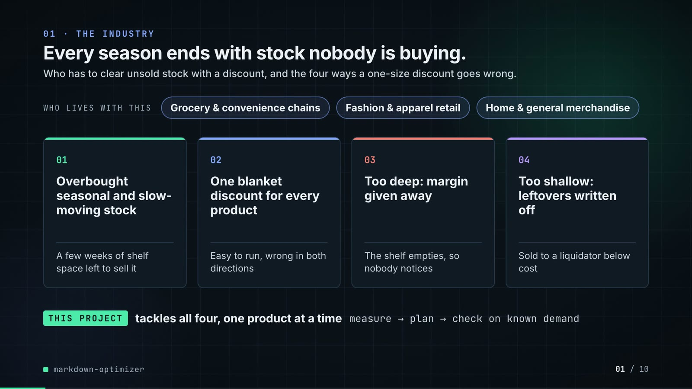

**On-screen text (verbatim)**

> 01 · THE INDUSTRY  
> Every season ends with stock nobody is buying.  
> Who has to clear unsold stock with a discount, and the four ways a one-size discount goes wrong.  
> WHO LIVES WITH THIS · Grocery & convenience chains · Fashion & apparel retail · Home & general merchandise  
> 01 Overbought seasonal and slow-moving stock — A few weeks of shelf space left to sell it  
> 02 One blanket discount for every product — Easy to run, wrong in both directions  
> 03 Too deep: margin given away — The shelf empties, so nobody notices  
> 04 Too shallow: leftovers written off — Sold to a liquidator below cost  
> THIS PROJECT tackles all four, one product at a time · measure → plan → check on known demand  

**Figures on this slide**

| ID | Shown | Source · key | Calculation | Check |
|---|---|---|---|---|
| F-01 | 3 industry chips | `author's framing` · - | - | manual |
| F-02 | 4 problem cards | `README 'The problem'` · README lines 13-27 | - | ✓ |

**Assumptions:** A-13

**Illustrative, not data:**

- The whole slide is context; no repo figures.

**To change this slide:** Edit the chips (#ctx-c1..3) and cards (#ctx-k1..4) in compositions/s01-context.html. (project folder `docs/demo/source`).

### Slide 02: This project  
*6.8-12.0 s · composition `compositions/s02-hook.html`*

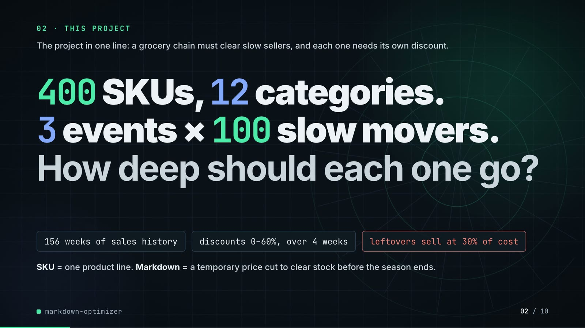

**On-screen text (verbatim)**

> 02 · THIS PROJECT  
> The project in one line: a grocery chain must clear slow sellers, and each one needs its own discount.  
> 400 SKUs, 12 categories. 3 events × 100 slow movers. How deep should each one go?  
> 156 weeks of sales history · discounts 0–60%, over 4 weeks · leftovers sell at 30% of cost  
> SKU = one product line. Markdown = a temporary price cut to clear stock before the season ends.  

**Figures on this slide**

| ID | Shown | Source · key | Calculation | Check |
|---|---|---|---|---|
| F-03 | 400 SKUs / seed 7 · 400 SKUs | `data/skus.csv` · row count | - | ✓ |
| F-04 | 12 categories | `data/skus.csv` · category (distinct) | - | ✓ |
| F-05 | 3 events | `data/events.csv` · event_id (distinct) | - | ✓ |
| F-06 | × 100 slow movers | `data/events.csv` · rows per event_id | min = max = 100 | ✓ |
| F-07 | 156 weeks of sales history | `data/sales.csv` · t (distinct) | - | ✓ |
| F-09 | discounts 0–60% / 0–60%, never rises | `src/markdown_optimizer/config.py:28` · LADDER | - | ✓ |
| F-10 | over 4 weeks / 4-week markdown path | `data/events.csv` · weeks | all rows = 4 | ✓ |
| F-11 | leftovers sell at 30% of cost | `data/events.csv; config.py:38` · salvage_value vs unit_cost | salvage_value = round(0.30 x unit_cost, 2) on every row | ✓ |
| F-12 | slow movers | `src/markdown_optimizer/data.py:241-243` · slow = SKUs below the 60th percentile of base demand | - | ✓ |

**Assumptions:** A-01, A-04, A-05

**Illustrative, not data:**

- Rings in the background are decoration.

**To change this slide:** Headline spans #hook-l1..l3, chips #hook-f1..f3 and #hook-def in compositions/s02-hook.html; sizes come from src/markdown_optimizer/config.py. (project folder `docs/demo/source`).

### Slide 03: How it works (white chapter, slide A)  
*11.7-19.7 s · composition `compositions/explainer.html (CONFIG.blocks, CONFIG.groups, CONFIG.loop)`*

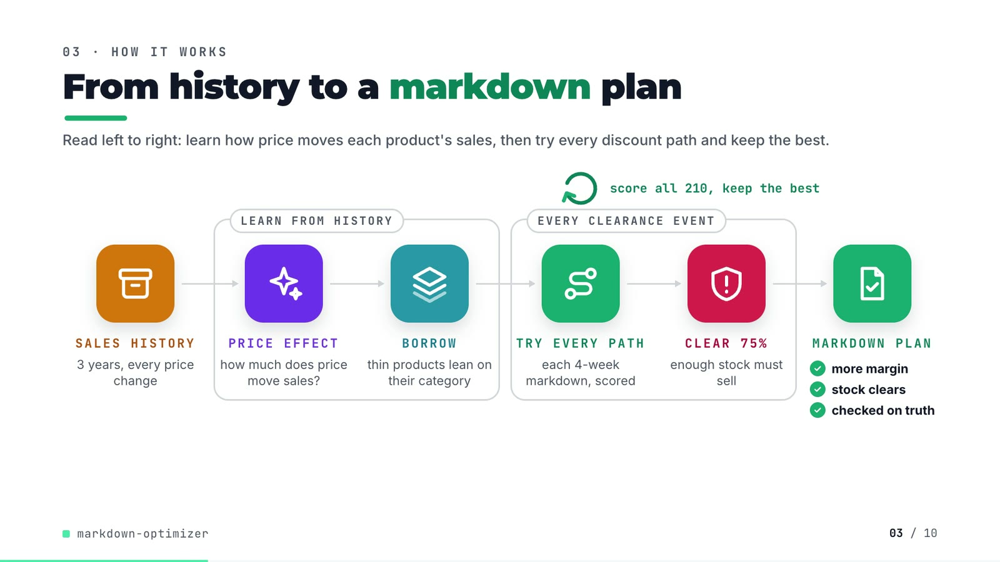

**On-screen text (verbatim)**

> 03 · HOW IT WORKS  
> From history to a markdown plan  
> Read left to right: learn how price moves each product's sales, then try every discount path and keep the best.  
> SALES HISTORY 3 years, every price change → [LEARN FROM HISTORY: PRICE EFFECT how much does price move sales? → BORROW thin products lean on their category] → [EVERY CLEARANCE EVENT: TRY EVERY PATH each 4-week markdown, scored → CLEAR 75% enough stock must sell] → MARKDOWN PLAN ✓ more margin ✓ stock clears ✓ checked on truth  
> score all 210, keep the best (loop over TRY EVERY PATH)  

**Figures on this slide**

| ID | Shown | Source · key | Calculation | Check |
|---|---|---|---|---|
| F-10 | over 4 weeks / 4-week markdown path | `data/events.csv` · weeks | all rows = 4 | ✓ |
| F-13 | 3 years, every price change | `data/sales.csv` · t (distinct) | 156 weeks / 52 = 3 years | ✓ |
| F-14 | score all 210 / 210 of them / 210 paths per SKU / scored 210 / 210 / best margin of 210 paths | `src/markdown_optimizer/optimize.py:25-27; config.py:28-34` · ladder_paths(4, 7) | non-decreasing sequences of 4 from 7 rungs = C(7+4-1, 4) = 210 | ✓ |
| F-15 | ✓ more margin ✓ stock clears ✓ checked on truth | `outputs/results.json; src/markdown_optimizer/simulate.py` · margin_partial_pooling > margin_fixed_30; sell_through_partial_pooling >= 0.75; simulate() scores on true_mean | - | ✓ |
| F-16 | CLEAR 75% / clears 75% / ≥ 75% sold? / target 75% / 75% must sell | `outputs/results.json` · sell_through_target | x 100 | ✓ |
| F-23 | thin products lean on their category / steadied by its category / Category blend · empirical Bayes · thin SKUs lean most | `src/markdown_optimizer/elasticity.py:93-120` · dersimonian_laird, shrink(groups=category) | - | ✓ |

**Assumptions:** A-03, A-05, A-07

**Illustrative, not data:**

- Icons and colours are a visual language, not data.

**To change this slide:** Edit CONFIG in compositions/explainer.html; badge truth comes from results.json (F-15). (project folder `docs/demo/source`).

### Slide 04: The key idea (white chapter, slide B)  
*19.7-26.7 s · composition `compositions/explainer.html (#ex-b ...)`*

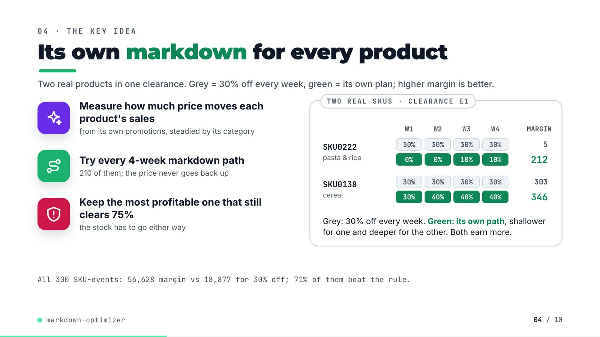

**On-screen text (verbatim)**

> 04 · THE KEY IDEA  
> Its own markdown for every product  
> Two real products in one clearance. Grey = 30% off every week, green = its own plan; higher margin is better.  
> Measure how much price moves each product's sales — from its own promotions, steadied by its category  
> Try every 4-week markdown path — 210 of them; the price never goes back up  
> Keep the most profitable one that still clears 75% — the stock has to go either way  
> TWO REAL SKUS · CLEARANCE E1 — SKU0222 pasta & rice: 30% ×4 (margin 5) vs 0% 0% 10% 10% (212); SKU0138 cereal: 30% ×4 (303) vs 30% 40% 40% 40% (346)  
> Grey: 30% off every week. Green: its own path, shallower for one and deeper for the other. Both earn more.  
> All 300 SKU-events: 56,628 margin vs 18,877 for 30% off; 71% of them beat the rule.  

**Figures on this slide**

| ID | Shown | Source · key | Calculation | Check |
|---|---|---|---|---|
| F-10 | over 4 weeks / 4-week markdown path | `data/events.csv` · weeks | all rows = 4 | ✓ |
| F-14 | score all 210 / 210 of them / 210 paths per SKU / scored 210 / 210 / best margin of 210 paths | `src/markdown_optimizer/optimize.py:25-27; config.py:28-34` · ladder_paths(4, 7) | non-decreasing sequences of 4 from 7 rungs = C(7+4-1, 4) = 210 | ✓ |
| F-16 | CLEAR 75% / clears 75% / ≥ 75% sold? / target 75% / 75% must sell | `outputs/results.json` · sell_through_target | x 100 | ✓ |
| F-17 | SKU0222 0% 0% 10% 10% · 5 → 212 | `outputs/markdown_plan.csv` · event_id=E1, sku_id=SKU0222: depth_w1..w4, margin, fixed_30_margin | margins rounded to whole units | ✓ |
| F-18 | SKU0138 30% 40% 40% 40% · 303 → 346 | `outputs/markdown_plan.csv` · event_id=E1, sku_id=SKU0138 | margins rounded to whole units | ✓ |
| F-19 | 56,628 | `outputs/results.json` · margin_partial_pooling | - | ✓ |
| F-20 | 18,877 | `outputs/results.json` · margin_fixed_30 | - | ✓ |
| F-21 | 71% of them beat the rule | `outputs/markdown_summary.csv` · policy=partial_pooling, skus_better_than_fixed | x 100 | ✓ |
| F-22 | the price never goes back up / never rises | `outputs/markdown_plan.csv; optimize.py:1-6` · depth_w1..w4 non-decreasing on all 300 rows | - | ✓ |
| F-23 | thin products lean on their category / steadied by its category / Category blend · empirical Bayes · thin SKUs lean most | `src/markdown_optimizer/elasticity.py:93-120` · dersimonian_laird, shrink(groups=category) | - | ✓ |

**Assumptions:** A-02, A-03, A-05, A-06, A-07

**Illustrative, not data:**

- The two SKUs were picked to show one shallower and one deeper path than 30%; 29% of SKU-events do not beat the rule (F-21).

**To change this slide:** Markup under #ex-b in compositions/explainer.html; the SKU rows are F-17/F-18, the footnote F-19/F-20/F-21. (project folder `docs/demo/source`).

### Slide 05: Architecture  
*26.4-43.4 s · composition `compositions/s03-architecture.html (N = nodes, W = wires)`*

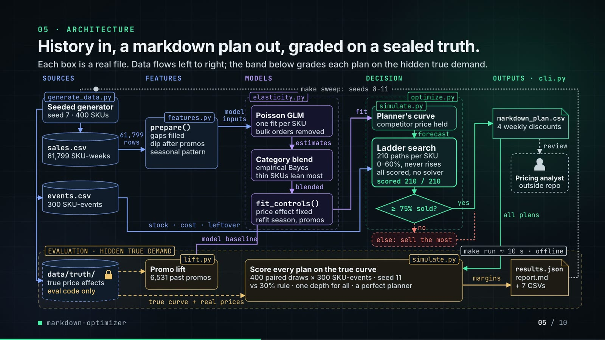

**On-screen text (verbatim)**

> 05 · ARCHITECTURE  
> History in, a markdown plan out, graded on a sealed truth.  
> Each box is a real file. Data flows left to right; the band below grades each plan on the hidden true demand.  
> Layers: SOURCES · FEATURES · MODELS · DECISION · OUTPUTS · cli.py; band: EVALUATION · HIDDEN TRUE DEMAND  
> generate_data.py Seeded generator (seed 7 · 400 SKUs) → sales.csv (61,799 SKU-weeks), events.csv (300 SKU-events), data/truth/ (true price effects · eval code only)  
> sales.csv —61,799 rows→ features.py prepare() (gaps filled · dip after promos · seasonal pattern) —model inputs→ elasticity.py: Poisson GLM (one fit per SKU · bulk orders removed) —estimates→ Category blend (empirical Bayes · thin SKUs lean most) —blended→ fit_controls() (price effect fixed · refit season, promos)  
> —fit→ simulate.py Planner's curve (competitor price held) —forecast→ optimize.py Ladder search (210 paths per SKU · 0–60%, never rises · all scored, no solver · scored 210 / 210) → ≥ 75% sold? —yes→ markdown_plan.csv (4 weekly discounts) —review→ Pricing analyst (outside repo); —no→ else: sell the most  
> events.csv —stock · cost · leftover→ ladder search; fit_controls —model baseline→ lift.py Promo lift (6,531 past promos); data/truth —true curve + real prices→ simulate.py Score every plan on the true curve (400 paired draws × 300 SKU-events · seed 11; vs 30% rule · one depth for all · a perfect planner); markdown_plan —all plans→ scorer —margins→ results.json (report.md + 7 CSVs) ··make sweep: seeds 8-11··> generator  
> make run ≈ 10 s · offline; critical path: sales.csv → markdown_plan.csv  

**Figures on this slide**

| ID | Shown | Source · key | Calculation | Check |
|---|---|---|---|---|
| F-03 | 400 SKUs / seed 7 · 400 SKUs | `data/skus.csv` · row count | - | ✓ |
| F-08 | 61,799 SKU-weeks / 61,799 rows | `data/sales.csv` · row count (1% of SKU-weeks dropped as missing files) | - | ✓ |
| F-09 | discounts 0–60% / 0–60%, never rises | `src/markdown_optimizer/config.py:28` · LADDER | - | ✓ |
| F-14 | score all 210 / 210 of them / 210 paths per SKU / scored 210 / 210 / best margin of 210 paths | `src/markdown_optimizer/optimize.py:25-27; config.py:28-34` · ladder_paths(4, 7) | non-decreasing sequences of 4 from 7 rungs = C(7+4-1, 4) = 210 | ✓ |
| F-16 | CLEAR 75% / clears 75% / ≥ 75% sold? / target 75% / 75% must sell | `outputs/results.json` · sell_through_target | x 100 | ✓ |
| F-22 | the price never goes back up / never rises | `outputs/markdown_plan.csv; optimize.py:1-6` · depth_w1..w4 non-decreasing on all 300 rows | - | ✓ |
| F-23 | thin products lean on their category / steadied by its category / Category blend · empirical Bayes · thin SKUs lean most | `src/markdown_optimizer/elasticity.py:93-120` · dersimonian_laird, shrink(groups=category) | - | ✓ |
| F-24 | generate_data.py, sales.csv, events.csv, features.py prepare(), Poisson GLM, Category blend (empirical Bayes), fit_controls(), simulate.py planner's curve, optimize.py ladder search, markdown_plan.csv, data/truth/, lift.py, simulate.py scorer, results.json, report.md, cli.py | `src/markdown_optimizer/*.py; scripts/; data/; outputs/` · see helper arch_boxes_exist() | - | ✓ |
| F-25 | no → else: sell the most | `src/markdown_optimizer/optimize.py:50-57` · choose() | - | ✓ |
| F-26 | seed 7 / seed 11 | `outputs/results.json; src/markdown_optimizer/simulate.py:74` · seed; simulate(seed=11) | - | ✓ |
| F-27 | 6,531 past promos | `outputs/lift_summary.csv` · baseline=model, promotions | - | ✓ |
| F-28 | 400 paired draws × 300 SKU-events | `src/markdown_optimizer/pipeline.py:62; data/events.csv` · run(draws=400); events rows | - | ✓ |
| F-29 | + 7 CSVs | `src/markdown_optimizer/cli.py:24-31` · to_csv(out / ...) calls | count | ✓ |
| F-30 | make run ≈ 10 s · offline / ~10 s | `measured for this audit` · - | 9.9 s wall-clock, rounded | manual |
| F-31 | offline | `src/markdown_optimizer/*.py; README 'Tests'` · no networking imports | - | ✓ |
| F-32 | data/truth/ · true price effects · eval code only · sealed | `src/markdown_optimizer/data.py:1-7; README 'The data'` · docstring + README | - | ✓ |
| F-33 | competitor price held | `src/markdown_optimizer/simulate.py:21-35; pipeline.py:73` · model_demand(last_cpi) | - | ✓ |
| F-34 | Poisson GLM · one fit per SKU · bulk orders removed | `src/markdown_optimizer/elasticity.py:31-64; pipeline.py:16` · poisson_irls, fit_robust (OUTLIER_PEARSON = 5.0), ESTIMATORS | - | ✓ |
| F-35 | make sweep: seeds 8-11 | `Makefile; outputs/seed_sweep.csv` · seed column | - | ✓ |

**Assumptions:** A-01, A-03, A-05, A-07, A-08, A-14

**Illustrative, not data:**

- Packets moving along the wires show execution order, not data volumes or timing.
- 'Pricing analyst · outside repo' is the consumer of the plan; the repo has no review step.
- Solid = batch data flow, dashed = sealed truth or human hand-off, dotted = seed-sweep loop.
- Off the critical path, boxes dim to 75% opacity (text stays >= 4.5:1).

**To change this slide:** Node table N and wire table W in compositions/s03-architecture.html; each box is checked by arch_boxes_exist() (F-24). (project folder `docs/demo/source`).

### Slide 06: The system running  
*43.0-57.6 s · composition `compositions/s04-running.html (DATA block injected by tools/inject_running.py)`*

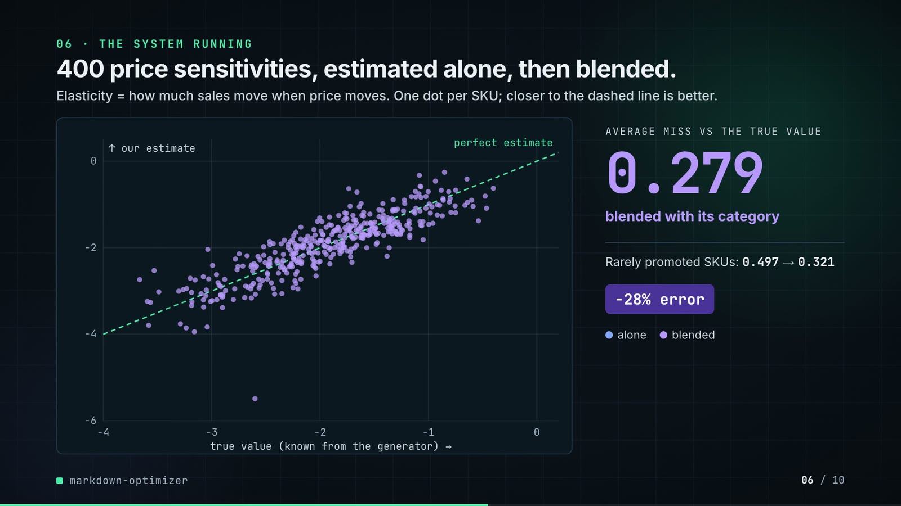

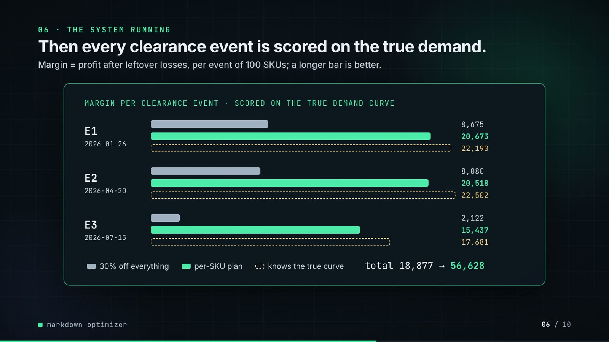

**On-screen text (verbatim)**

> 06 · THE SYSTEM RUNNING  
> 400 price sensitivities, estimated alone, then blended.  
> Elasticity = how much sales move when price moves. One dot per SKU; closer to the dashed line is better.  
> Scatter: true value (known from the generator) vs our estimate; perfect estimate line; AVERAGE MISS VS THE TRUE VALUE 0.385 (each SKU on its own) → 0.279 (blended with its category); Rarely promoted SKUs: 0.497 → 0.321; −28% error  
> Then every clearance event is scored on the true demand.  
> Margin = profit after leftover losses, per event of 100 SKUs; a longer bar is better.  
> MARGIN PER CLEARANCE EVENT · SCORED ON THE TRUE DEMAND CURVE — E1 2026-01-26: 8,675 / 20,673 / 22,190; E2 2026-04-20: 8,080 / 20,518 / 22,502; E3 2026-07-13: 2,122 / 15,437 / 17,681  
> 30% off everything · per-SKU plan · knows the true curve · total 18,877 → 56,628  

**Figures on this slide**

| ID | Shown | Source · key | Calculation | Check |
|---|---|---|---|---|
| F-19 | 56,628 | `outputs/results.json` · margin_partial_pooling | - | ✓ |
| F-20 | 18,877 | `outputs/results.json` · margin_fixed_30 | - | ✓ |
| F-36 | 0.385 / estimate error 0.385 | `outputs/results.json` · beta_mae_no_pooling | - | ✓ |
| F-37 | 0.279 / estimate error 0.279 | `outputs/results.json` · beta_mae_partial_pooling | - | ✓ |
| F-38 | Rarely promoted SKUs: 0.497 | `outputs/elasticity_error.csv` · estimator=no_pooling, beta_mae_few_promos | - | ✓ |
| F-39 | → 0.321 | `outputs/elasticity_error.csv` · estimator=partial_pooling, beta_mae_few_promos | - | ✓ |
| F-40 | −28% error / −28% / Blending cut the error 28% | `outputs/results.json` · beta_mae_partial_pooling, beta_mae_no_pooling | (0.2792 / 0.3854 - 1) x 100 = -27.6, rounded | ✓ |
| F-41 | 400 points moving from 'alone' to 'pooled' | `outputs/elasticity_by_sku.csv (inlined by tools/inject_running.py)` · beta_true, beta_hat for estimator in {no_pooling, partial_pooling} | values rounded to 3 decimals for drawing | ✓ |
| F-42 | 9 bar values | `outputs/markdown_by_event.csv (inlined by tools/inject_running.py)` · policy in {fixed_30, partial_pooling, oracle}, event_id, margin | - | ✓ |
| F-43 | total 18,877 | `outputs/markdown_by_event.csv` · policy=fixed_30, margin | sum of E1..E3 | ✓ |
| F-44 | → 56,628 | `outputs/markdown_by_event.csv` · policy=partial_pooling, margin | sum of E1..E3 | ✓ |

**Assumptions:** A-02, A-07, A-11

**Illustrative, not data:**

- The repo writes no plots; both charts are drawn by the video from the CSVs, values unchanged (F-41, F-42).

**To change this slide:** Re-run make run, then tools/inject_running.py; layout in compositions/s04-running.html. (project folder `docs/demo/source`).

### Slide 07: End-user value (white)  
*57.3-70.3 s · composition `compositions/value.html (SHEET block injected by tools/inject_sheet.py)`*

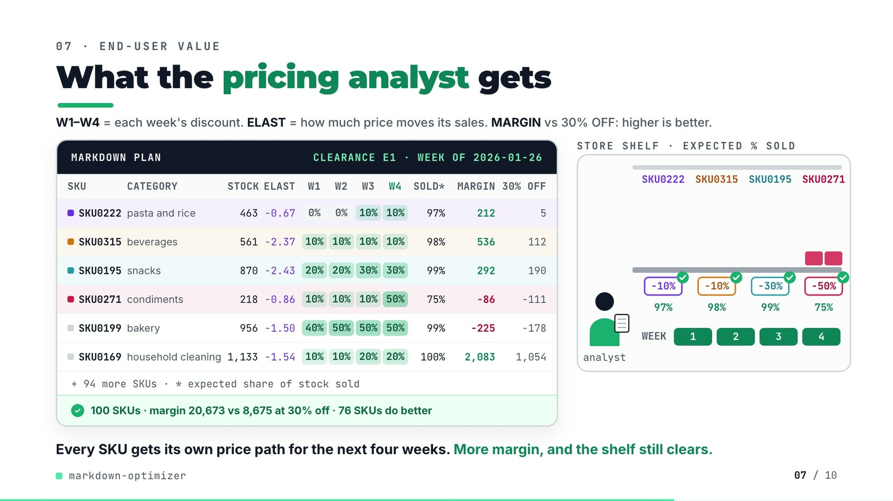

**On-screen text (verbatim)**

> 07 · END-USER VALUE  
> What the pricing analyst gets  
> W1–W4 = each week's discount. ELAST = how much price moves its sales. MARGIN vs 30% OFF: higher is better.  
> MARKDOWN PLAN · CLEARANCE E1 · WEEK OF 2026-01-26 — columns SKU, CATEGORY, STOCK, ELAST, W1, W2, W3, W4, SOLD*, MARGIN, 30% OFF  
> SKU0222 pasta and rice 463 −0.67 0% 0% 10% 10% 97% 212 5  
> SKU0315 beverages 561 −2.37 10% 10% 10% 10% 98% 536 112  
> SKU0195 snacks 870 −2.43 20% 20% 30% 30% 99% 292 190  
> SKU0271 condiments 218 −0.86 10% 10% 10% 50% 75% −86 −111  
> SKU0199 bakery 956 −1.50 40% 50% 50% 50% 99% −225 −178  
> SKU0169 household cleaning 1,133 −1.54 10% 10% 20% 20% 100% 2,083 1,054  
> + 94 more SKUs · * expected share of stock sold · ✓ 100 SKUs · margin 20,673 vs 8,675 at 30% off · 76 SKUs do better  
> STORE SHELF · EXPECTED % SOLD — price tags full → weekly depth, WEEK 1-4, 97% / 98% / 99% / 75%  
> Every SKU gets its own price path for the next four weeks. More margin, and the shelf still clears.  

**Figures on this slide**

| ID | Shown | Source · key | Calculation | Check |
|---|---|---|---|---|
| F-16 | CLEAR 75% / clears 75% / ≥ 75% sold? / target 75% / 75% must sell | `outputs/results.json` · sell_through_target | x 100 | ✓ |
| F-17 | SKU0222 0% 0% 10% 10% · 5 → 212 | `outputs/markdown_plan.csv` · event_id=E1, sku_id=SKU0222: depth_w1..w4, margin, fixed_30_margin | margins rounded to whole units | ✓ |
| F-45 | 6 sheet rows | `demo:assets/markdown_sheet.json (tools/export_markdown_sheet.py) = outputs/markdown_plan.csv rows for E1` · see helper sheet_rows_match() | - | ✓ |
| F-46 | margin 20,673 | `outputs/markdown_by_event.csv` · policy=partial_pooling, event_id=E1 | - | ✓ |
| F-47 | vs 8,675 at 30% off | `outputs/markdown_by_event.csv` · policy=fixed_30, event_id=E1 | - | ✓ |
| F-48 | 76 SKUs do better | `outputs/markdown_plan.csv` · event_id=E1, margin > fixed_30_margin | count | ✓ |
| F-49 | 100 SKUs · + 94 more SKUs | `data/events.csv` · event_id=E1 rows | 100 - 6 shown = 94 | ✓ |
| F-50 | −0.67 | `outputs/elasticity_by_sku.csv` · sku_id=SKU0222, estimator=partial_pooling, beta_hat | - | ✓ |
| F-51 | 75% / 75% (shelf) | `outputs/markdown_plan.csv` · event_id=E1, sku_id=SKU0271, planned_sell_through | x 100 | ✓ |
| F-52 | shelf animation | `demo:assets/markdown_sheet.json` · planned_stock_left | boxes left = round(10 x expected stock left) | manual |

**Assumptions:** A-03, A-04, A-06, A-07, A-08, A-09

**Illustrative, not data:**

- Analyst figure, shelf, 10 boxes per SKU and tag drawings are illustrative (F-52).
- The 6 rows were picked to show a range of paths, including one SKU (SKU0199) where the plan loses to 30% off.
- MARGIN and 30% OFF are scored on the true demand curve; SOLD* is the planner's expectation.

**To change this slide:** Re-run tools/export_markdown_sheet.py, then tools/inject_sheet.py (--rows / --animate pick the SKUs); layout in compositions/value.html. (project folder `docs/demo/source`).

### Slide 08: Results  
*70.0-78.8 s · composition `compositions/s05-results.html (stats array)`*

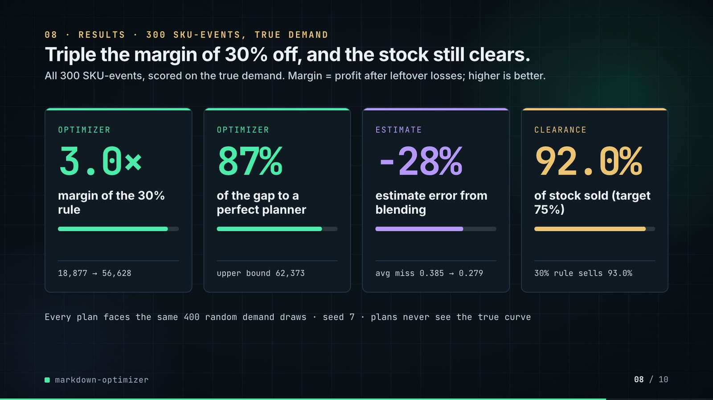

**On-screen text (verbatim)**

> 08 · RESULTS · 300 SKU-EVENTS, TRUE DEMAND  
> Triple the margin of 30% off, and the stock still clears.  
> All 300 SKU-events, scored on the true demand. Margin = profit after leftover losses; higher is better.  
> OPTIMIZER 3.0× margin of the 30% rule · 18,877 → 56,628  
> OPTIMIZER 87% of the gap to a perfect planner · upper bound 62,373  
> ESTIMATE −28% estimate error from blending · avg miss 0.385 → 0.279  
> CLEARANCE 92.0% of stock sold (target 75%) · 30% rule sells 93.0%  
> Every plan faces the same 400 random demand draws · seed 7 · plans never see the true curve  

**Figures on this slide**

| ID | Shown | Source · key | Calculation | Check |
|---|---|---|---|---|
| F-16 | CLEAR 75% / clears 75% / ≥ 75% sold? / target 75% / 75% must sell | `outputs/results.json` · sell_through_target | x 100 | ✓ |
| F-19 | 56,628 | `outputs/results.json` · margin_partial_pooling | - | ✓ |
| F-20 | 18,877 | `outputs/results.json` · margin_fixed_30 | - | ✓ |
| F-26 | seed 7 / seed 11 | `outputs/results.json; src/markdown_optimizer/simulate.py:74` · seed; simulate(seed=11) | - | ✓ |
| F-28 | 400 paired draws × 300 SKU-events | `src/markdown_optimizer/pipeline.py:62; data/events.csv` · run(draws=400); events rows | - | ✓ |
| F-36 | 0.385 / estimate error 0.385 | `outputs/results.json` · beta_mae_no_pooling | - | ✓ |
| F-37 | 0.279 / estimate error 0.279 | `outputs/results.json` · beta_mae_partial_pooling | - | ✓ |
| F-40 | −28% error / −28% / Blending cut the error 28% | `outputs/results.json` · beta_mae_partial_pooling, beta_mae_no_pooling | (0.2792 / 0.3854 - 1) x 100 = -27.6, rounded | ✓ |
| F-53 | 3.0× | `outputs/results.json` · margin_partial_pooling / margin_fixed_30 | 56,628 / 18,877 = 3.0 | ✓ |
| F-54 | 87% / 87% of the gap to a perfect planner | `outputs/results.json` · oracle_headroom_captured | x 100 | ✓ |
| F-55 | upper bound 62,373 | `outputs/results.json` · margin_oracle | - | ✓ |
| F-56 | 92.0% | `outputs/results.json` · sell_through_partial_pooling | x 100 | ✓ |
| F-57 | 30% rule sells 93.0% | `outputs/results.json` · sell_through_fixed_30 | x 100 | ✓ |

**Assumptions:** A-02, A-03, A-06, A-07, A-09

**Illustrative, not data:**

- Mini bars: card 1 = margin / upper bound (from 30% rule to plan), card 2 = share captured, card 3 = MAE after / before, card 4 = share sold.

**To change this slide:** The stats array and card text in compositions/s05-results.html. (project folder `docs/demo/source`).

### Slide 09: Lesson and fix  
*78.4-87.4 s · composition `compositions/s06-twist.html`*

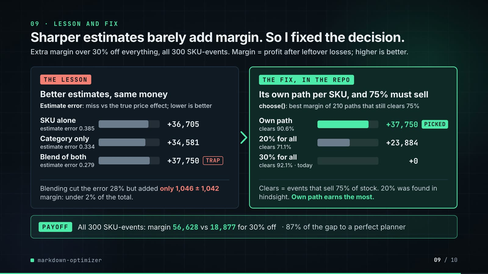

**On-screen text (verbatim)**

> 09 · LESSON AND FIX  
> Sharper estimates barely add margin. So I fixed the decision.  
> Extra margin over 30% off everything, all 300 SKU-events. Margin = profit after leftover losses; higher is better.  
> THE LESSON — Better estimates, same money. Estimate error: miss vs the true price effect; lower is better.  
> SKU alone (estimate error 0.385) +36,705 · Category only (estimate error 0.334) +34,581 · Blend of both (estimate error 0.279) +37,750 [TRAP]  
> Blending cut the error 28% but added only 1,046 ± 1,042 margin: under 2% of the total.  
> THE FIX, IN THE REPO — Its own path per SKU, and 75% must sell. choose(): best margin of 210 paths that still clears 75%  
> Own path (clears 90.6%) +37,750 [PICKED] · 20% for all (clears 71.1%) +23,884 · 30% for all (clears 92.1% · today) +0  
> Clears = events that sell 75% of stock. 20% was found in hindsight. Own path earns the most.  
> PAYOFF — All 300 SKU-events: margin 56,628 vs 18,877 for 30% off · 87% of the gap to a perfect planner  

**Figures on this slide**

| ID | Shown | Source · key | Calculation | Check |
|---|---|---|---|---|
| F-14 | score all 210 / 210 of them / 210 paths per SKU / scored 210 / 210 / best margin of 210 paths | `src/markdown_optimizer/optimize.py:25-27; config.py:28-34` · ladder_paths(4, 7) | non-decreasing sequences of 4 from 7 rungs = C(7+4-1, 4) = 210 | ✓ |
| F-16 | CLEAR 75% / clears 75% / ≥ 75% sold? / target 75% / 75% must sell | `outputs/results.json` · sell_through_target | x 100 | ✓ |
| F-19 | 56,628 | `outputs/results.json` · margin_partial_pooling | - | ✓ |
| F-20 | 18,877 | `outputs/results.json` · margin_fixed_30 | - | ✓ |
| F-36 | 0.385 / estimate error 0.385 | `outputs/results.json` · beta_mae_no_pooling | - | ✓ |
| F-37 | 0.279 / estimate error 0.279 | `outputs/results.json` · beta_mae_partial_pooling | - | ✓ |
| F-40 | −28% error / −28% / Blending cut the error 28% | `outputs/results.json` · beta_mae_partial_pooling, beta_mae_no_pooling | (0.2792 / 0.3854 - 1) x 100 = -27.6, rounded | ✓ |
| F-54 | 87% / 87% of the gap to a perfect planner | `outputs/results.json` · oracle_headroom_captured | x 100 | ✓ |
| F-58 | +23,884 | `outputs/markdown_summary.csv` · policy=best_blanket_depth_hindsight, margin_vs_fixed_30 | - | ✓ |
| F-59 | 20% for all · 20% was found in hindsight | `outputs/results.json` · best_blanket_depth | x 100 | ✓ |
| F-60 | +36,705 | `outputs/markdown_summary.csv` · policy=no_pooling, margin_vs_fixed_30 | - | ✓ |
| F-61 | +37,750 | `outputs/markdown_summary.csv` · policy=partial_pooling, margin_vs_fixed_30 | - | ✓ |
| F-63 | only 1,046 | `outputs/pooling_comparison.csv` · comparison='partial_pooling - no_pooling', margin_difference | - | ✓ |
| F-64 | ± 1,042 | `outputs/pooling_comparison.csv` · comparison='partial_pooling - no_pooling', ci95_halfwidth | 1.96 x sd x sqrt(n) | ✓ |
| F-65 | Sharper estimates barely add margin. So I fixed the decision. | `README 'The result'` · README sentence | - | ✓ |
| F-68 | +34,581 | `outputs/markdown_summary.csv` · policy=complete_pooling, margin_vs_fixed_30 | - | ✓ |
| F-69 | estimate error 0.334 | `outputs/elasticity_error.csv` · estimator=complete_pooling, beta_mae | - | ✓ |
| F-70 | clears 90.6% | `outputs/markdown_summary.csv` · policy=partial_pooling, share_events_hitting_target | x 100 | ✓ |
| F-71 | clears 71.1% | `outputs/markdown_summary.csv` · policy=best_blanket_depth_hindsight, share_events_hitting_target | 0.7105 exactly (71.05%); x 100, rounded half up to 1 dp as in the README (Python's float format would give 71.0) | ✓ |
| F-72 | clears 92.1% · today | `outputs/markdown_summary.csv` · policy=fixed_30, share_events_hitting_target | x 100 | ✓ |
| F-73 | THE FIX, IN THE REPO · choose(): best margin of 210 paths that still clears 75% | `src/markdown_optimizer/optimize.py:50-73; tests/test_optimize.py:26` · choose(), plan_events() | - | ✓ |
| F-74 | under 2% of the total | `outputs/pooling_comparison.csv; outputs/results.json` · margin_difference / margin_partial_pooling | 1,046 / 56,628 = 1.8% | ✓ |

**Assumptions:** A-02, A-03, A-06, A-07, A-09

**Illustrative, not data:**

- Bar lengths: one shared scale in both panels, 240 px track = +45,000 margin over the 30% rule.
- 'TRAP' marks the option that looks like the win (lowest estimate error) but adds almost no margin; all lesson bars are neutral grey on purpose.
- 'Own path' and 'Blend of both' are the same policy (partial pooling + per-SKU ladder search), shown once on each panel.

**To change this slide:** Rows #twist-l1..l3 / #twist-r1..r3 (bar widths are inline styles) and #twist-payoff in compositions/s06-twist.html. (project folder `docs/demo/source`).

### Slide 10: End card  
*87.0-91.4 s · composition `compositions/s07-end.html`*

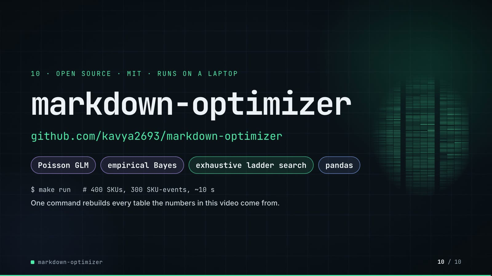

**On-screen text (verbatim)**

> 10 · OPEN SOURCE · MIT · RUNS ON A LAPTOP  
> markdown-optimizer  
> github.com/kavya2693/markdown-optimizer  
> Poisson GLM · empirical Bayes · exhaustive ladder search · pandas  
> $ make run   # 400 SKUs, 300 SKU-events, ~10 s  
> One command rebuilds every table the numbers in this video come from.  

**Figures on this slide**

| ID | Shown | Source · key | Calculation | Check |
|---|---|---|---|---|
| F-30 | make run ≈ 10 s · offline / ~10 s | `measured for this audit` · - | 9.9 s wall-clock, rounded | manual |
| F-66 | MIT | `LICENSE` · first line | - | ✓ |
| F-67 | Poisson GLM · empirical Bayes · exhaustive ladder search · pandas | `src/markdown_optimizer/elasticity.py; optimize.py; pyproject.toml` · docstrings + dependencies | - | ✓ |

**Assumptions:** A-14

**Illustrative, not data:**

- Faded grid on the right is outputs/markdown_plan.csv drawn as a heatmap (rows = SKU-events by event, columns = weeks, darker = deeper), by tools/plan_heatmap.py.

**To change this slide:** Text in compositions/s07-end.html; heatmap from tools/plan_heatmap.py. (project folder `docs/demo/source`).

## 5. Change-impact matrix

| Input / assumption | Affected figures | Affected slides | Files to edit | Commands to re-run |
|---|---|---|---|---|
| A-01: All data is synthetic, produced by a seeded generator sized to the production problem (400 SKUs in 12 categories, 156 weeks, three 4-week clearance events of 100 slow movers) | all figures | 01, 02, 03, 04, 05, 06, 07, 08, 09, 10 | `src/markdown_optimizer/config.py; src/markdown_optimizer/data.py` | `make data; make run` |
| A-02: The generator and the estimator share the same constant-elasticity log-log demand form, so model misspecification costs nothing here | F-17, F-18, F-19, F-36, F-37, F-38, F-39, F-40, F-41, F-42, F-43, F-44, F-53, F-54, F-58, F-60, F-61, F-63, F-64, F-68 | 04, 06, 07, 08, 09 | `src/markdown_optimizer/data.py:49-69` | `make data; make run` |
| A-03: A plan must reach 75% expected sell-through over the event; otherwise the path that sells the most is taken (fallback) | F-16, F-25, F-45, F-51, F-56, F-70, F-71, F-72, F-73 | 03, 04, 05, 07, 08, 09 | `src/markdown_optimizer/config.py:36` | `make run; export_markdown_sheet.py + inject_sheet.py` |
| A-04: Leftover units at the end of an event go to a liquidator at 30% of unit cost | F-11, F-17, F-18, F-19, F-20, F-43, F-44, F-46, F-47, F-53, F-58, F-60, F-61, F-68 | 02, 04, 06, 07, 08, 09 | `src/markdown_optimizer/config.py:38` | `make data; make run` |
| A-05: Markdown ladder: 0-60% in 10-point steps, 4 weeks per event, depth never goes back up, so every SKU-event has exactly 210 candidate paths, all scored | F-09, F-10, F-14, F-22 | 02, 03, 04, 05, 09 | `src/markdown_optimizer/config.py:28-34` | `make run` |
| A-06: The business-as-usual baseline is 30% off every SKU for all four weeks | F-17, F-18, F-20, F-21, F-44, F-47, F-48, F-53, F-57, F-58, F-60, F-61, F-68 | 04, 06, 07, 08, 09 | `src/markdown_optimizer/config.py:29` | `make run` |
| A-07: Plans are scored on the true demand curve with 400 paired negative-binomial demand draws per SKU-event (scorer seed 11, size 40, about 16% noise on a high-volume SKU), using the competitor prices that actually happened | F-15, F-19, F-20, F-26, F-28, F-43, F-44, F-46, F-47, F-53, F-54, F-56, F-57, F-58, F-60, F-61, F-63, F-64, F-68 | 03, 04, 05, 06, 07, 08, 09 | `src/markdown_optimizer/simulate.py:73-74; src/markdown_optimizer/data.py:22` | `make run` |
| A-08: When planning, the competitor price index is held at its last observed value and competitors do not react to our markdowns | F-33, F-19, F-44, F-53 | 04, 05, 06, 08, 09 | `src/markdown_optimizer/simulate.py:21-35` | `make run` |
| A-09: The planner optimises expected demand, not a demand quantile; noise pushes some events below the 75% line (90 | F-51, F-56, F-57, F-70, F-72 | 07, 08, 09 | `src/markdown_optimizer/optimize.py` | `make run` |
| A-10: No cannibalisation or halo between SKUs; one price zone at chain level | F-19, F-44, F-53 | 04, 06, 08, 09 | `src/markdown_optimizer/data.py; src/markdown_optimizer/simulate.py` | `make data; make run` |
| A-11: True own-price elasticities are drawn around category means of -1 | F-36, F-37, F-38, F-39, F-40, F-41 | 06, 08, 09 | `src/markdown_optimizer/config.py:13-24; src/markdown_optimizer/data.py:110` | `make data; make run` |
| A-12: Video rounding: margins to whole currency units with thousands separators, percentages to whole numbers or 1 decimal, elasticity MAE to 3 decimals, elasticities to 2 decimals; '~10 s' and '3 years' are rounded labels; event hit rates to 1 decimal | F-13, F-19, F-20, F-21, F-36, F-37, F-38, F-39, F-40, F-43, F-44, F-46, F-47, F-50, F-51, F-53, F-54, F-55, F-56, F-57, F-58, F-60, F-61, F-63, F-64, F-68 | 03, 04, 06, 07, 08, 09 | `the composition file named on each slide` | `hyperframes render` |
| A-13: Slide 01 (industry, everyday problems) is general retail knowledge used as context | F-01, F-02 | 01 | `compositions/s01-context.html` | `hyperframes render` |
| A-14: The 'make run ≈ 10 s' label is a single wall-clock measurement on the author's laptop (Apple M1 Pro), not a repo output; it varies with the machine | F-30 | 05, 10 | `compositions/s03-architecture.html (#arch-nfr); compositions/s07-end.html (#endcard-run)` | `hyperframes render` |

## 6. Known differences and caveats

- All data is synthetic and the generator shares the estimator's constant-elasticity form, so the evaluation cannot catch a wrong functional form (README 'Known limitations', biggest gap).
- The two SKUs on slide 04 and the six rows on slide 07 are chosen examples; 29% of SKU-events do worse than or tie the 30% rule (F-21), and slide 07 includes one such SKU (SKU0199).
- SOLD* on slide 07 and the shelf animation use the planner's expected demand; MARGIN and 30% OFF are realised means over 400 draws on the true curve.
- The plan sells through slightly less than the 30% rule (92.0% vs 93.0%) and hits the 75% target on 90.6% of events vs 92.1% (README 'The result'); slide 08 shows the sell-through pair and slide 09 the hit-rate trio. Closing that gap (planning on the 25th percentile of demand) is a README next step, not built.
- Slide 09 no longer shows the oracle row (+43,496 over the 30% rule, README 'The result' table) or the 'complete pooling is beaten by partial pooling by 3,169 ± 1,893' comparison (outputs/pooling_comparison.csv); slide 08 still shows the oracle total (62,373).
- The architecture slide no longer names the 4 estimators or the no-markdown arm; both are in the README results table and outputs/markdown_summary.csv.
- 'make run ≈ 10 s' is one measurement on the author's laptop (A-14).
- The repo writes no plots; slide 06 charts are drawn by the video from the output CSVs (values unchanged).
- Slide 01 statements are general retail knowledge (A-13).
- 'Pricing analyst · outside repo' on slide 05 marks the consumer of the plan; the repo has no human review step.

## Appendix: environment

- Commit: `53fed34eb58576187392a2d38677502d4ffbe523`
- Python: 3.11.7
- numpy 2.4.6
- pandas 3.0.6
- Profile / seeds: data=7, scorer=11, demand_draws=400
- Run time: make run (data + study, no sweep) took 9.9 s wall-clock on the author's laptop (Apple M1 Pro); the repo itself does not record a run time
